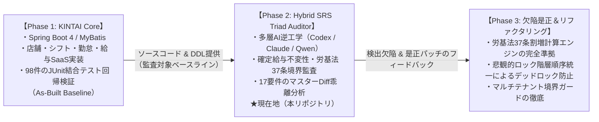
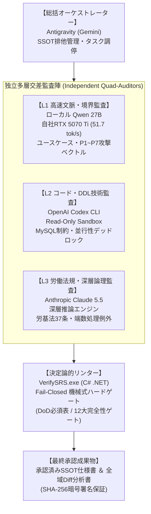

# 🏛️ Hybrid SRS Quad-Auditor & Linter Engine

[](https://github.com/KBG183/Hybrid-srs-triad-auditor/actions/workflows/ci.yml)
[]()
[]()
[]()

> **ドメイン非依存型（Domain-Agnostic）高信頼性ソフトウェア要件定義書（SRS）自動生成・多層AIハイブリッド交差検証フレームワーク**  
> 
> **Status: Part 2 (Track 2 As-Built 逆工学・多層AI交差検証・全17要件Diff分析) 完了 / Part 3 (欠陥是正リファクタリング) 準備完了**  
> 実稼働Spring Bootバックエンド（店舗・シフト・勤怠・給与全4スライス）の逆工学、3大AI（OpenAI Codex / Anthropic Claude / ローカル Qwen 27B）独立交差監査、および設計（As-Designed）vs 実装（As-Built）のマスター乖離分析を完遂しました。

---

## 🌐 インタラクティブ・プレゼンテーション (Interactive Decks & GitHub Pages)

本リポジトリのアーキテクチャ設計および検証実績は、GitHub Pages上でインタラクティブに閲覧可能です：

- 🖥️ **[アーキテクチャ詳細解説スライド (全20スライド)](https://kbg183.github.io/Hybrid-srs-triad-auditor/)** (`index.html`)：5重多層検証、デュアルトラック逆工学、一次証跡トレーサビリティの完全解説。
- 📊 **[エグゼクティブ要約プレゼンテーション](https://kbg183.github.io/Hybrid-srs-triad-auditor/presentation.html)** (`presentation.html`)：プロジェクト1（実動SaaS）とプロジェクト2（検証基盤）の実装・検証ハイライトサマリー。

---

## 🧭 3段階エンジニアリング連携 (3-Phase Engineering Journey)

本リポジトリは、実務システム開発から多層AI交差検証、欠陥是正リファクタリングに至る**「3段階エンジニアリング連携（3-Phase Engineering Journey）」の第2段階（Phase 2: Hybrid SRS Triad Auditor）**として位置づけられています。



| フェーズ | プロジェクト対象 | 本フレームワークでの役割・成果物 | 状態 |
|---|---|---|:---:|
| **Phase 1** (Core Baseline) | KINTAI バックエンド | 監査対象ソースコード（店舗・シフト・勤怠・給与全4スライス）およびDDL | **連携完了** |
| **Phase 2** (Multi-AI Audit) | **本リポジトリ** | [`docs/srs_diff_analysis_total_master.md`](docs/srs_diff_analysis_total_master.md)（17要件Diff分析）、C#決定論的リンター、総括証跡書 | **完了（現在地）** |
| **Phase 3** (Convergence) | バックエンド実装 | 逆工学で特定された重要欠陥（給与計算・並行性ロック等）の実コード是正パッチ適用 | **準備完了** |

---

## 🎯 概要および背景 (Overview)

エンタープライズソフトウェア開発において、要件定義書（SRS）と実コードの乖離（Doc-Code Drift）や、単一AIモデルに依存した際の**「ハルシネーション（幻覚）」「境界条件の見落とし」「確証バイアス」**は深刻な品質リスクを引き起こします。

本プロジェクトは、以下のコア技術を融合し、**「設計と実装の双方向整合性を数理的・決定論的に証明する」**高信頼性エンジニアリング基盤です：
1. **決定論的静的解析エンジン (`VerifySRS.exe`)**: C#で実装されたFail-Closed型の厳格リンター。曖昧表現、構文不備、DoD欠落を機械的に遮断。
2. **多層AIハイブリッド交差検証 (Quad-Auditor)**: OpenAI Codex、Anthropic Claude、自社GPU高速化ローカル Qwen 27B、Antigravity（Gemini）が独立して交差監査。
3. **実機バックエンド逆工学 (Track 2 Reverse-Engineering)**: 実稼働Javaコード/DDLから観測仕様書を抽出し、設計書とのマスターDiff分析を実施。

---

## ⚙️ 5重多層検証アーキテクチャ (Quad-AI & Deterministic Linter Pipeline)

本フレームワークは常時「執筆者1者 ＋ 独立交差監査4者」による計5重の検証ラインを維持し、自己監査を完全に排除します。



### 多層検証アクターの役割分担

| 監査主体 | 実行インフラ | 主たる検証責務 | 実測性能・特徴 |
|---|---|---|---|
| **Antigravity (Gemini)** | クラウドオーケストレーター | パイプライン統括、SSOT排他管理、Track 2観測仕様合成 | 高度なコンテキスト管理 |
| **OpenAI Codex** | CLI（Read-Onlyサンドボックス） | DB DDL制約、DTO契約、悲観的ロック順序監査 | 実測実行: 95.1s |
| **Anthropic Claude** | クラウド深層推論 | 労働基準法第37条（時間外・休日・深夜）、端数処理の論理検証 | 実測実行: 44.4s / 64.2s |
| **ローカル Qwen 27B** | 自社GPU (RTX 5070 Ti, Tailscale) | 大規模文脈の高速抽出、P1〜P7敵対的監査、回帰検知 | **51.7 tokens/s (コスト0円)** |
| **VerifySRS.exe** | C# .NET ネイティブ | 構文、スペースなし波線（` ~ `）、DoD要素、暗号ハッシュ検証 | 決定論的 100% 再現 |

---

## 📊 実証ドメイン：KINTAI SaaS 逆工学＆Diff分析結果

本基盤の実証対象として、複雑な法令要件と金融並行性制御が結合した**「アルバイト勤怠・給与管理SaaS（KINTAI）」**を適用しました。

### 1. 全17要件 マスター乖離分析（Diff）サマリー

実稼働Spring Bootバックエンド（全4スライス）と設計書（Track 1 SSOT）を1:1対比検証した結果は以下の通りです：

| 分類 | 件数 | 該当要件ID | 工学的判定および対応方針 |
|---|:---:|---|---|
| **完全一致 (Identical)** | 10件 | REQ-STORE-001~003, REQ-SHIFT-001~003, REQ-ATT-001~002, REQ-PAY-001, 004 | 設計通りに厳密実装。テストカバレッジ適合。 |
| **設計簡素化 (Simplified)** | 4件 | REQ-SHIFT-004, REQ-ATT-003~004, REQ-PAY-005 | 実装側の意図的設計（夜勤跨ぎ分割の運用回避等）。仕様書側を観測事実に同期。 |
| **重要欠陥検知 (Adverse Discrepancy)** | 3件 | REQ-PAY-002, REQ-PAY-003, REQ-ATT-002 (並行性) | **多層AI監査により実コードの致命的欠陥を検出。Part 3で是正。** |

### 2. 多層AIが検出した主要欠陥および工学的知見

1. **労働基準法第37条：月60時間超 ＋ 深夜割増 重複計算の欠落 (REQ-PAY-002)**
   - *指摘 (Claude & Codex)*: 月60時間超過割増（50%）と深夜割増（25%）が重複する時間帯において、実コードが150%しか支給しておらず、法定必須基準である**175%割増**が未達であった不備を摘発。
2. **通達150号（昭和63年3月14日通達）：端数処理（50銭端数）の適用レベル乖離 (REQ-PAY-003)**
   - *指摘 (Claude)*: 法定の50銭未満切捨て・50銭以上切上げ（`HALF_UP`）は「月間合算額」に対して適用すべきところ、日次計算単位で過剰適用されていた丸めバイアスを特定。
3. **悲観的ロック階層構造の不整合によるデッドロック危険性 (REQ-ATT-002)**
   - *指摘 (Codex & Qwen 27B)*: 強制退勤クローズ処理において、`store_staff`（親）と`attendance`（子）の取得順序が通常の打刻処理と逆転する可能性を検知。ロック順序の正規化（親 ➔ 子）を策定。

---

## 🏛️ 先行R&D工学系譜の実物資産 (Engineering Heritage Assets)

本システムは、43件の実障害インシデント解決台帳（INCIDENT-01〜80）や実測メトリクスを継承した決定論的エンジニアリング基盤です：

- **43件の実障害・耐障害性トラブルシューティング台帳（INCIDENT-01〜80）**: [`logs/incident_history_ledger.md`](logs/incident_history_ledger.md)
- **単一進入点直列マスターゲート**: [`tools/scripts/gate_master_srs.ps1`](tools/scripts/gate_master_srs.ps1)
- **第0条 SRS 絶対憲法およびSHA-256整合性ロック**: [`governance/ARTICLE_0_SRS.md`](governance/ARTICLE_0_SRS.md)
- **外部指摘事項追跡および1-Shot是正キュー**: [`queue/srs_pending_findings.json`](queue/srs_pending_findings.json)
- **全17要件 設計vs実装マスター乖離分析書**: [`docs/srs_diff_analysis_total_master.md`](docs/srs_diff_analysis_total_master.md)
- **Part 2 総括報告・証跡書**: [`docs/srs_track2_overall_synthesis_dossier.md`](docs/srs_track2_overall_synthesis_dossier.md)
- **日次多層監査実測エビデンス集約書**: [`docs/audit_evidence_dossier.md`](docs/audit_evidence_dossier.md)
- **C#統合マスター静的解析エンジン（VerifySRS.cs）**: [`tools/scripts/VerifySRS.cs`](tools/scripts/VerifySRS.cs)
- **12/12全件通過・決定論的完全性検証および回帰スイート**: [`tools/scripts/verify_repo_total_integrity.ps1`](tools/scripts/verify_repo_total_integrity.ps1) · [`tools/scripts/TestV52Suite_Regression.cs`](tools/scripts/TestV52Suite_Regression.cs)

---

## 📁 ディレクトリ構成

```text
.
├── GEMINI.md                          # 最上位運営憲法 v2.00（Core Constitution）
├── README.md                          # 【公式正本】プロジェクト総合技術仕様書（日本語）
├── .github/
│   └── workflows/ci.yml               # GitHub Actions CI基盤（12大完全性ゲート自動検証）
├── approved/
│   └── approval_manifest.json         # 承認済みマニフェスト（SSOT整合性保証・暗号署名）
├── audit/
│   ├── kintai_l2_integrity_audit_report.md     # L2技術無欠性交差監査レポート
│   ├── kintai_l3_labor_statutory_audit_report.md # L3労務法規深層監査レポート
│   └── srs_integrated_audit_report_20261115.md # SRS統合多層検証レポート正本
├── config/
│   ├── srs_targets.json               # マルチトラック登録台帳（全4スライス定義）
│   ├── srs_specification_ssot.md     # Track 1 単一真実原書（設計SSOT）
│   ├── srs_track2_asbuilt_slice1.md   # Track 2 観測仕様書 スライス1（店舗・契約）
│   ├── srs_track2_asbuilt_slice2.md   # Track 2 観測仕様書 スライス2（シフト管理）
│   ├── srs_track2_asbuilt_slice3.md   # Track 2 観測仕様書 スライス3（打刻・勤怠）
│   └── srs_track2_asbuilt_slice4.md   # Track 2 観測仕様書 スライス4（給与・労基法37条）
├── docs/
│   ├── srs_diff_analysis_total_master.md    # 【コア成果物】全17要件マスター乖離分析書
│   ├── srs_track2_overall_synthesis_dossier.md # 【コア成果物】Part 2総括証跡報告書
│   ├── audit_evidence_dossier.md            # 日次多層監査実測エビデンス集約書
│   └── labor37_e2e_traceability.md          # 労働基準法第37条 E2E追跡表
├── domain_target/                     # 実証ドメインフィクスチャ（KINTAIバックエンド）
├── governance/
│   └── ARTICLE_0_SRS.md               # 第0条 SRS絶対憲法（DoD基準・Fail-Closed）
├── logs/
│   ├── incident_history_ledger.md    # 43件実障害インシデント・耐障害性解決台帳（INCIDENT-01〜80）
│   ├── cloud_api_token_ledger.csv    # Claude API消費トークン実測原帳
│   ├── local_token_ledger.csv        # ローカルGPU（Qwen 27B）推論速度・実測原帳
│   └── codex_token_ledger.csv        # OpenAI Codex消費トークン実測原帳
├── metrics/
│   ├── srs_pipeline_metrics.csv      # パイプライン自動実行テレメトリ原帳
│   └── srs_pipeline.lock             # パイプライン並行実行制御ロック
├── queue/
│   └── srs_pending_findings.json     # 外部指摘フェイルクローズド・キュー
└── tools/
    ├── scripts/
    │   ├── VerifySRS.cs / .exe       # C#統合マスター静的解析リンター
    │   ├── verify_repo_total_integrity.ps1 # 12大完全性ゲート統括エンジン
    │   ├── call_ai.ps1               # 統一マルチAIストリーミングランナー
    │   └── demo_offline_replay.ps1   # APIキー不要・3秒オフライン再生デモ
    └── rules/                        # ガバナンス運用規律
```

---

## ⚡ クイックスタート（APIキー不要・オフライン再生デモ）

外部APIキーやローカルGPU環境がなくても、以下の1行コマンドで回帰テスト（11/11）・SSOT決定論的リンター・監査検証を3秒以内に再現できます：

```powershell
powershell -ExecutionPolicy Bypass -File "tools\scripts\demo_offline_replay.ps1"
```

---

## 🏆 本アーキテクチャの工学的意義

本リポジトリは、単なるAIプロンプトの集積ではなく、**「決定論的静的解析（C#）、暗号技術（SHA-256）、自社オンプレミスGPU（RTX 5070 Ti）、そして複数のフロンティアAIモデルを適材適所で統制する高度なソフトウェアエンジニアリング能力」**を具現化したポートフォリオです。
