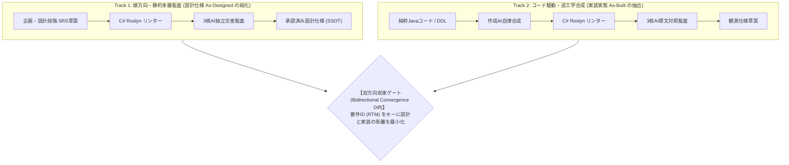
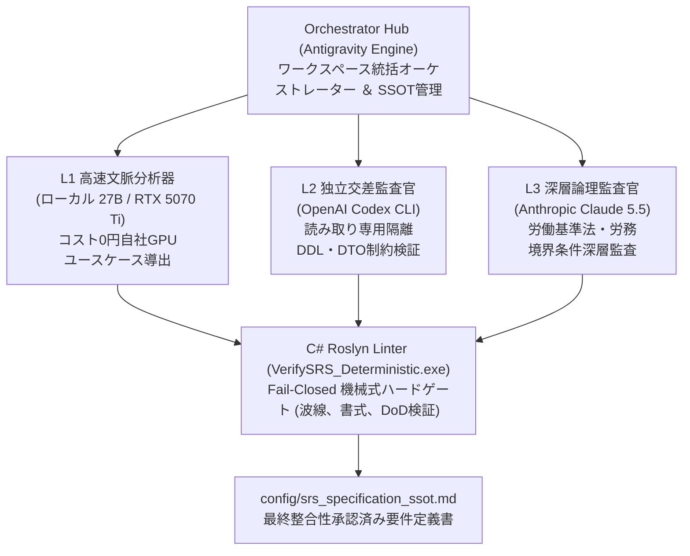

# 🏛️ Hybrid SRS Quad-Auditor & Linter Engine

> **ドメイン非依存型（Domain-Agnostic）高信頼性ソフトウェア要件定義書（SRS）自動生成・4核AI多層相互監査フレームワーク**  

> **Status: 開発中（WIP）** — 現在、開発AIと独立ローカルLLM監査を分離したハイブリッド開発・監査パイプライン、およびガバナンス規約の検証・高度化を進めています。  
> 仕様・ディレクトリ構成・スクリプトは予告なく変更される場合があります。

---

## 🎯 概要および背景 (Overview)

本プロジェクトは、大規模エンタープライズソフトウェアの要件定義（SRS）策定において発生する**「単一LLMのハルシネーション（幻覚）」「曖昧な境界条件の見落とし」「確証バイアス」**を根本から排除するために構築された、**マルチモデル協調オーケストレーション ＋ 自社GPU高速化インフラ ＋ C#決定論的リンターを結合した高信頼性エンジニアリング基盤**です。

---

## 🏛️ 先行R&D工学系譜の実物資産 (Engineering Heritage Assets)

本システムは、突如としてゼロから作られたものではありません。  
数万行におよぶ大規模テキストの整合性を検証するため、先行して独自開発された**C# Roslynリンター（783行）、9/9回帰テストスイート、42件の実障害インシデント解決台帳、モデル別実測トークン・コストCSVデータ**をエンタープライズ系譜として直接継承・統合しています。

- **42件の実障害・耐障害性トラブルシューティング台帳**: [`logs/incident_history_ledger.md`](logs/incident_history_ledger.md)
  *(ハルシネーション、無限ループ、スキーマ不整合をC#ハードゲートで迎撃した全記録)*
- **C# Roslyn決定論的静的解析エンジン（VerifySRS_Integrity.cs）**: [`tools/scripts/VerifySRS_Integrity.cs`](tools/scripts/VerifySRS_Integrity.cs)
- **9/9全件通過・決定論的回帰テストスイート**: [`tools/scripts/TestV52Suite_Regression.cs`](tools/scripts/TestV52Suite_Regression.cs)
- **大規模ベンチマーク・テストフィクスチャ（5種）**: [`tools/fixtures/`](tools/fixtures/)
- **モデル別トークン消費・コスト実測原帳（CSV 5種）**: [`logs/`](logs/) (`cloud_api_token_ledger.csv`, `local_token_ledger.csv`, `enterprise_audit_ledger.csv`, `pipeline_metrics.csv`, `evidence_benchmark.csv`)

---

## 🎯 実証リファレンスドメイン (Reference Domain Fixture)

本フレームワークの検証精度と実効性を実証するため、複雑な法令計算（日本労働基準法第37条の割増賃金）と金融トランザクション並行性制御（悲観的ロック）が結合した**[KINTAI：店舗・アルバイト勤怠および給与計算バックエンド](domain_target/)**を第1次実証ドメインフィクスチャとして搭載・稼働させています。

* ※ `domain_target/` 配下のドメインアセットを差し替えることで、フィンテック、医療、物流などあらゆる高信頼性産業システムに即時適用可能なプラグ＆プレイ（Plug & Play）アーキテクチャを実現しています。

---

## 🔄 2大独立検証トラック・アーキテクチャ (Dual-Track Verification Methodology)

本フレームワークは、単一のAIに要件定義書を書かせて終わる一般的なアプローチとは異なり、ソフトウェア開発ライフサイクル（SDLC）の品質を双方向から保証する**「2大独立検証トラック（Dual-Track）」**を設計・運用しています。  
情報漏洩（Information Leakage）や確証バイアスを防ぐため、両トラックはコンテキストを物理的に隔離（Blind Isolation）した状態で並行稼働します。



### 1. Track 1: 順方向・静的多層監査 (Forward Static Multi-Audit)
* **目的**: 企画・設計段階のSRS草案に対し、実装着手前に論理破綻、曖昧性、法規違反、例外の欠落を静的に検知・低減（Shift-Left Defect Detection）。
* **入力**: 人間設計者または企画段階で策定された要件定義書草案。
* **検証パイプライン**:
  1. **C# Roslyn Linter (`VerifySRS_Deterministic.exe`)**: DoD必須表、フォーマット、TBD/TODO残存を機械的にFail-Closed遮断。
  2. **L1 高速文脈監査 (Local 27B Qwen, RTX 5070 Ti)**: 業務ユースケースの網羅性および分岐欠落をコスト0円で高速検知。
  3. **L2 独立技術監査 (OpenAI Codex CLI, Read-Only Sandbox)**: MySQL 8.4 DDL制約、API DTO契約、トランザクション分離の整合性を監査。
  4. **L3 労務法規監査 (Anthropic Claude 5.5)**: 日本労働基準法第37条（割増賃金計算）への準拠性を深層推論監査。

### 2. Track 2: コード駆動・逆工学自動合成＆独立交差検証 (Reverse-Engineering Synthesis & Cross-Audit)
* **目的**: 実装済みバックエンドソースコードおよびDDLから、AIがIEEE 830形式の構造化SRSを逆合成（Auto-Generation）し、その合成品質を3核の独立AIが原文コードと突き合わせて客観的に検証。
* **入力**: 実動バックエンドソース（`PayrollCalculationService.java`, `ShiftService.java`）およびDDL（`schema.sql`）。
* **ブラインド隔離原則 (Blind Isolation)**: 作成AIには既存の設計書を入力せず、**純粋なコード資産のみを読解**させることで、先入観による引きずられやカンニングを排除。
* **検証パイプライン**:
  1. **作成エンジン (Antigravity / Gemini)**: ソースコードの数式、トランザクション境界、例外処理を逆解析し、新規SRSを自律合成。
  2. **C# Roslyn Linter**: 合成されたSRSの状態遷移表、入出力仕様の欠落を1次スクリーニング。
  3. **L1〜L3 独立交差監査陣 (Qwen 27B / Codex / Claude)**: 作成AIから切り離された3核AIが、要件IDをキーとして**「実コード原文 vs 合成されたSRS」を照合監査**。
     * *実証例 (L1)*: Javaコード内の例外分岐（`IllegalArgumentException`）がSRSの例外仕様に漏れなく定義されているか？
     * *実証例 (L2)*: 悲観的ロック（`SELECT ... FOR UPDATE`）のタイムアウト制御がSRSの並行性要件と一致しているか？
     * *実証例 (L3)*: Javaで実装された「50銭未満切捨て・50銭以上切上げ」端数処理が、労働基準法第37条の観点からSRSに正しく記述されているか？

### 3. 双方向収束ゲート (Bidirectional Convergence Gate) による工学的価値
両トラックの出力を要件トレーサビリティ行列（RTM）をキーにして突き合わせることで、実務で頻発する**「設計書とコードの乖離（Doc-Code Drift）」**を最小化します：
* **SSOTの単一性確保**: Track 1の成果物を「承認済み単一真実原書（Approved SSOT）」、Track 2の成果物を「実装実態の観測仕様（Observed Spec）」として位置づけ、差分は人間エンジニアが仲裁・承認（コード修正または仕様書是正）して単一SSOTを維持。
* **コード側の不備検知**: 設計書に規定されているが、実コードに未実装である仕様（例: 週40時間超過割増の漏れ）を特定。
* **設計側の不備検知**: 実コードには堅牢に組まれているが、設計書で記述漏れしていた暗黙のシステム制約（例: 悲観的ロック競合時のリトライ上限3回）を検出し、仕様書へ反映。

---

## ⚙️ 4核AI編隊（Quad-Orchestration）＆ 整合性ハードゲート



1. **総括オーケストレーター (Antigravity / Gemini)**: ワークスペース全体のタスク調停、ファイル入出力制御、単一真実原書（SSOT）の排他的管理
2. **L1 高速文脈分析器 (ローカル Qwen 27B, RTX 5070 Ti)**: 低遅延P2Pリモートアクセラレーションにより、数万トークンのドメインドラフト・境界条件の骨子を追加コスト0円で超高速生成
3. **L2 独立交差監査官 (OpenAI Codex CLI, Read-Only Sandbox)**: 読み取り専用隔離サンドボックスにおいて、DDL制約、DTO契約、並行性デッドロック等のコードレベル整合性を交差監査（トークン保護ファイルポインタ適用）
4. **L3 深層論理監査官 (Anthropic Claude 5.5)**: 日本労働基準法第37条への準拠性、端数処理（50銭未満切捨て・50銭以上切上げ）、労使紛争シナリオの深層監査（従量課金保護ポリシー準拠）
5. **C# Roslyn決定論的リンター (`VerifySRS_Deterministic.exe`)**: AIが見落としやすいスペースなし波線（` ~ `）、TBD/TODOの残存、5大必須要素（入力・処理・出力・例外・DoD）の欠落をコンパイラレベルで機械的に完全遮断（Fail-Closed原則）

---

## 📁 ディレクトリ構成

```text
.
├── GEMINI.md                          # 最上位運営憲法 v1.02（多言語ガバナンス・Fail-Closed規定）
├── README.md                          # 【公式正本】プロジェクト総合技術仕様書（日本語）
├── config/
│   └── srs_specification_ssot.md     # 単一真実原書（SRS SSOT）
├── audit/
│   ├── kintai_l2_integrity_audit_report.md     # L2技術無欠性交差監査レポート
│   ├── kintai_l3_labor_statutory_audit_report.md # L3労務法規深層監査レポート（従量課金保護方針により未実施・注記のみ）
│   ├── srs_integrated_audit_report_20261115.md # SRS統合多層検証レポート正本
│   ├── F001_F003_human_review_errata.md        # 人によるレビュー正誤表（労基法37条F-001却下・F-003保留）
│   ├── srs_integrated_audit_template.md        # 監査レポート標準フォーマット
│   └── runs/                                   # 実行別マニフェスト・エビデンス束
├── logs/
│   ├── CURRENT_STATUS.md             # プロジェクト統括ステータス台帳
│   ├── incident_history_ledger.md    # 42件実障害インシデント・耐障害性解決台帳 (21.7KB実物)
│   ├── pipeline_metrics.md           # パイプライン健全性・実行メトリクス
│   ├── cloud_api_token_ledger.csv    # クラウドAPI消費トークン・コスト実測原帳
│   ├── local_token_ledger.csv        # ローカルGPU推論速度・トークン実測原帳
│   ├── enterprise_audit_ledger.csv   # エンタープライズ全数監査実測原帳
│   ├── pipeline_metrics.csv          # CI/CD統合レイテンシ計測データ
│   └── evidence_benchmark.csv        # 決定論的検証ベンチマークデータ
├── tools/
│   ├── scripts/                      # 実行スクリプトおよび決定論的エンジン
│   │   ├── hermes_controller.ps1     # 4核統合コントローラー（Linter -> Qwen -> Codex -> Claude）
│   │   ├── call_qwen.ps1             # 自社RTX 5070 Tiリモート高速化ラッパー
│   │   ├── call_codex.ps1            # Codex CLIサンドボックスラッパー（トークン保護）
│   │   ├── call_claude.ps1           # Claude 5.5 API呼び出しラッパー
│   │   ├── VerifySRS_Integrity.cs    # C#決定論的静的解析エンジン（テキスト無欠性・ヒューマンエラー遮断）
│   │   ├── VerifySRS_Deterministic.cs# C#決定論的リンターソース（Windows標準 csc.exeでビルド）
│   │   ├── TestV52Suite_Regression.cs# 9/9決定論的回帰テストスイート
│   │   ├── verify_srs.ps1            # リンター検証スクリプト
│   │   └── verify_integrity.ps1      # テキスト無欠性検証スクリプト
│   ├── rules/                        # ガバナンス運用規律
│   │   ├── sandbox_execution_policy.md         # 読み取り専用サンドボックス運用ポリシー
│   │   └── srs_authoring_multi_audit_protocol.md # SRS作成および多層検証プロトコル
│   ├── fixtures/                     # 大規模ベンチマーク・テストフィクスチャ（5種）
│   └── cross_audit/                  # 交差監査契約
│       └── audit_contract_srs.md     # 監査契約定義書
└── domain_target/                     # 実証ドメインフィクスチャ（KINTAI勤怠・給与システム）
    ├── 01_specifications_and_rtm/    # kintai_master_srs 分割スライス 1〜3
    ├── 02_database_schema_ssot/      # MySQL 8.4 DDL (schema.sql, data.sql)
    ├── 03_core_domain_services/      # 労働基準法37条計算エンジン、悲観的ロック等
    ├── 04_api_contracts_and_dtos/    # API契約およびDTO
    └── 05_core_domain_tests_fixtures/# 単体・統合テストフィクスチャ
```

---

## 🏆 本アーキテクチャの工学的意義

本リポジトリは、単なるAIプロンプトの集積ではなく、**「コンパイラ（C# Roslyn）、暗号技術（SHA-256/HMAC）、オンプレミスGPU（RTX 5070 Ti）、そして複数の最先端フロンティアAIを適材適所で指揮する高度なシステムアーキテクチャ設計・運用能力」**を具現化したエンジニアリングポートフォリオです。
