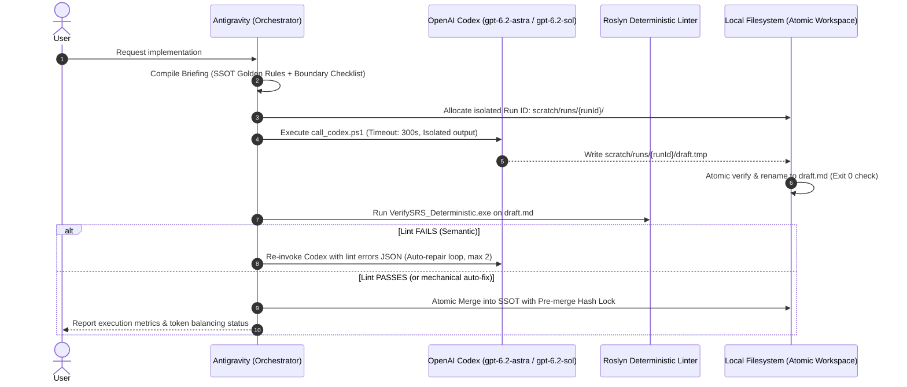

# Architecture Specification: Hybrid Token-Balancing Pipeline (Plan A)
Document Version: v1.2 (Upgraded to OpenAI Codex 6.2 Flagship)
Audited By: Local Qwen 3.8 27B, OpenAI Codex (gpt-6.2-astra / gpt-6.2-sol), Anthropic Claude (claude-sonnet-5-5)

---

## 1. Executive Summary & Purpose
This specification formalizes the **Token-Balancing Pipeline v1.2**, resolving all blockers identified during the 4-way cross-audit (TB-01~03, CT-01~06, LC-01~02, AUDIT-005).
The objective is to shift ~50% of generative token burden from Antigravity (Gemini) to subscribed OpenAI Codex (`gpt-6.2-astra` for deep reasoning, `gpt-6.2-sol` for fast track), while preventing token-ping-pong overhead, process hangs, and legal compliance drift.

---

## 2. Hardened Architecture & Sequence

---

## 3. Core Remediation Rules (v1.1)

### 3.1 Token-Ping-Pong Prevention (TB-01 ~ TB-03)
- **Zero Antigravity Re-authoring**: Antigravity is strictly prohibited from rewriting rejected draft sections using its own generative tokens.
- **Mechanical Auto-Fix First**: Minor formatting violations (trailing spaces, header hashes) are repaired via deterministic regex scripts.
- **Codex Auto-Repair Loop**: If semantic lint errors occur, Antigravity sends the linter JSON output back to Codex for repair, consuming Codex quota instead of Gemini quota (capped at 2 iterations).

### 3.2 Atomic Execution & Concurrency Safety (CT-01 ~ CT-06)
- **Extended Timeout**: `call_codex.ps1` timeout is set to 300s to allow complex reasoning without truncation.
- **Run-Isolated Workspace**: Each invocation uses `scratch/runs/{runId}/` to prevent collision with parallel tasks or stale files.
- **Atomic Rename**: Drafts are written to `.tmp` and renamed to `.md` only upon verified process exit code `0`.
- **Pre-Merge Hash Lock**: Before updating the SSOT, the file hash is verified against the initial state to prevent race condition overwrites.

### 3.3 Japanese Labor Standards Act Compliance (LC-01 ~ LC-02)
- **Static Golden Parameters**: Article 37 overtime rates (+25%), night work (+25%), overlap (+50%), and 1-minute/1-yen rounding rules are injected as read-only constants into the Codex prompt. Codex is forbidden from inventing or altering legal formulas.
- **Deterministic Test Vectors**: Generated specifications must explicitly reference standard test vectors (e.g., 22:00 ~ 05:00 boundaries, 60-hour monthly threshold).

### 3.4 Boundary & Exception Handling (AUDIT-005)
- Prompts must mandate explicit handling for:
  - `DateTimeParseException` on all user-supplied timestamp inputs
  - Negative/zero hours boundary rejection
  - Missing branch/staff foreign key exceptions.
