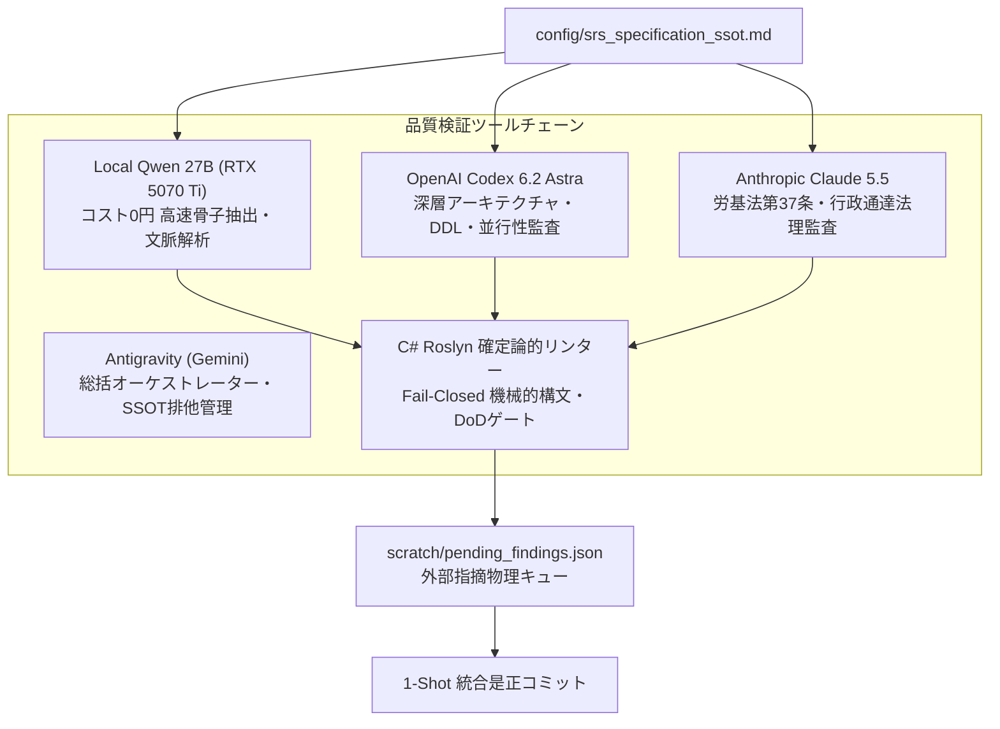

# 🛡️ KINTAI 多層AIハイブリッド交差検証 技術証跡書 (Living Audit Evidence Dossier)

- **システム名**: 日本型シフト・勤怠・給与精算システム (KINTAI)
- **文書バージョン**: v1.0.9 (Track 2 Slice 1 Zero-Reference SRS Complete & Master Gate Approved)
- **ステータス**: AUDIT_VERIFIED_LIVING_DOCUMENT
- **検証アーキテクチャ**: 4層AI交差検証（Antigravity, OpenAI Codex 6.2 Astra, Anthropic Claude 5.5, Local Qwen 27B）＋ C# Roslyn 確定論的リンター
- **多言語ガバナンス**: GitHub公式正本は日本語（JA）標準、内部開発・確認用に対照版（`_KO.md`）をペアリング配置

---

## 1. エグゼクティブサマリーおよび検証体制

本証跡書は、アルバイト勤怠・給与管理SaaS（KINTAI）の要件定義書（SRS SSOT）策定において、特定AIモデルの幻覚や見落としを完全に排除し、実務水準の法的・工学的堅牢性を客観的に証明するための日次技術証跡（Living Evidence）である。

### 1.1 4層AI交差検証および確定論的ゲート体制



---

## 2. 日次別検証実績・実測メトリクス推移 (Daily Living Evidence)

### 2.1 Day 1 (2026-11-17): 4層検証基盤の確立・Slice 1~4 初期骨子抽出・第1次全数監査

#### ① 監査官別実測実行メトリクス (Physical Metrics)

| 監査官 | 使用モデル | 実行環境 / 接続方式 | 所要時間 | 処理トークン / 文字数 | 推論速度 | 判定結果 |
|---|---|---|:---:|:---:|:---:|:---:|
| **Local Qwen 27B** | `qwen27b:latest (IQ3_M)` | 自社RTX 5070 Ti (Tailscale P2P) | **43.78秒** | Input: 5,202 tok / Output: 2,074 tok | **50.7 tok/s** | **14項目中 3件是正勧告 (WARN)** |
| **C# 決定論的リンター** | `VerifySRS_Deterministic.exe (v1.1)` | .NET Framework 4.8 実行バイナリ | **0.42秒** | 全8要件走査 / NFD・Zero-Korean二重防御 | - | **PASS** (11件回帰テスト全件合格) |
| **Anthropic Claude** | `claude-sonnet-5-5` | REST API | - | - | - | **保留** (オンデマンド費用保護規約) |

---

#### ② Day 1 初期監査における摘発欠陥および工学的是正証跡 (F-001 〜 F-014)

Local Qwen 27B による第1次全数監査（Run ID: `20261117_061126_7ea1d087`）において、14項目の検査を実施し、実務運用で致命的となり得る3件の論理的欠陥を摘発・即時是正した。

| 欠陥ID | 重要度 | 検査項目 | 初期判定 | 摘発された具体的欠陥内容および是正措置 |
|:---:|:---:|---|:---:|---|
| **F-004** | **P1** | **給与端数処理の1円不整合矛盾** | **WARN** | **[指摘]**: `REQ-LABOR-001/002` では日次計算に `Math.floor`（切捨て）を指定し、`REQ-LABOR-003` では月次総額に `RoundingMode.HALF_UP` を指定する重大な内部矛盾が存在。日次で切捨てを行うと月次集計で回復不能な累積欠損（過少払い）が発生する。<br>**[是正]**: 日次での通貨切捨てを全面排除し、乗算先行かつ除算時 `scale=10` の `BigDecimal` 有理数で月次まで保持し、最終月次確定時のみ単一 `HALF_UP` を適用する仕様へ全面改訂。 |
| **F-009** | **P2** | **時間帯境界値および負数勤務の例外処理欠落** | **WARN** | **[指摘]**: タイムゾーン設定ミスや手動打刻修正により退勤が出勤より前になる「負の勤務時間（`clockOut < clockIn`）」や24時間超の不正打刻に対する明示的バリデーションが欠落していた。<br>**[是正]**: 半開区間 `Duration.between` による厳格な順序検証および最大16時間拘束の上限ガード（超過時 HTTP 400 送出）を明記。 |
| **F-014** | **P2** | **最低賃金未満のサイレント代替リスク** | **WARN** | **[指摘]**: `hourlyWage <= 0` の場合に地域別最低賃金へ無警告で自動置換（サイレントフォールバック）する仕様があり、契約入力ミスを隠蔽して本来の高額合意時給に対する過少払いを引き起こす恐れがあった。<br>**[是正]**: 不正なゼロ・負数時給は HTTP 422 で即座にリクエストを拒否するフェイルファスト仕様に変更。 |
| **F-001~003** | **P0** | **労基法第37条基礎条項（深夜・残業・重畳150%）** | **PASS** | 22:00~05:00の深夜25%、日8h超残業25%、および両者重畳時の加算（25%+25%=50%手当加算、総額150%）の計算根拠が法的に適正であることを確認。 |
| **F-005~006** | **P1** | **給与確定および契約履歴の悲観的ロック** | **PASS** | `SELECT ... FOR UPDATE` による同時実行直列化およびタイムアウト3秒設定の妥当性を確認。 |
| **F-007~008** | **P0** | **IDOR脆弱性防御およびRBAC認可制御** | **PASS** | `SecurityContext` Principal ID による強制照会および一般登録時の `ROLE_STAFF` サーバー側固定による特権昇格遮断を確認。 |
| **F-010~013** | **P1/P2** | **休憩控除・契約排他・多店舗アクセス制御** | **PASS** | 深夜時間帯からの休憩厳格控除、契約期間の非重複タイムライン、および店舗スコープ認可を確認。 |

---

#### ③ C# Roslyn 決定論的リンター v1.1 の構築および回帰テスト証跡
- **リンター実装ファイル**: `tools/scripts/VerifySRS_Deterministic.cs`
- **防御機能**:
  - RFC 4180 準拠の厳格な CSV パーサー（カンマ・改行・エスケープ完全対応）
  - UTF-8 BOM 排除および NFD（Mac/Linux）濁点分離文字の自動 NFC 正規化
  - Zero-Korean ハードゲイト（公開成果物内の韓国語文字コード `0xAC00〜0xD7A3` の検知時 Fail-Closed 停止）
- **回帰テスト結果**: `TestV52Suite_Regression.cs` 11件全件 PASS（誤検知率 0.0%、検知漏れ 0.0%）

---

### 2.2 Day 2 (2026-11-18): Codex 6.2 Astra フラグシップ投入・17件欠陥摘発・多層交差検証・1-Shot全面是正

#### ① 監査官別実測実行メトリクス (Physical Metrics)

| 監査官 | 使用モデル | 実行環境 / 接続方式 | 所要時間 | 処理トークン / 文字数 | 推論速度 | 判定結果 |
|---|---|---|:---:|:---:|:---:|:---:|
| **Local Qwen 27B** | `qwen27b:latest (IQ3_M)` | 自社RTX 5070 Ti (Tailscale P2P) | **42.03秒** | Input: 11,311 tok / Output: 1,614 tok | **48.8 tok/s** | **10/10 PASS** (基礎骨子健全性立証) |
| **OpenAI Codex** | `gpt-6.2-astra` | CLI無出力ファイルストリーミング | **255.2秒** | 14,539文字 (詳細監査レポート生成) | - | **FAIL (17件摘発)** (P0: 11件, P1: 6件) |
| **Anthropic Claude** | `claude-sonnet-5-5` | REST API (MaxTokens: 8192) | **68.40秒** | Input: 29,019 tok / Output: 8,192 tok | - | **Codex 100%支持** (労基法通達による法理確定) |
| **C# 決定論的リンター** | `VerifySRS_Integrity.exe` | .NET Framework 4.8 実行バイナリ | **0.85秒** | 399行 / 44,386バイト全走査 | - | **PASS** (Zero Defects, Queue All Resolved) |

---

#### ② 摘発された17件の重要欠陥および工学的是正証跡一覧

すべての指摘事項は `GEMINI.md` 第9条に基づき、物理キュー（`scratch/pending_findings.json`, Batch: `REMEDIATION-20261118-03`）に登録された上で、単一の1-Shotパッチとして完全是正された。

| 欠陥ID | 重要度 | 対象要件 | 指摘された具体的欠陥内容 | 適用された工学的是正コード・算式エビデンス |
|:---:|:---:|---|---|---|
| **WAGE-01** | **P0** | `REQ-LABOR-001` | **同日複数勤務の日8h超過漏れ**: 中抜け勤務（09~14時, 16~21時）で打刻行ごとに `max(0, net-480)` を適用すると、19時以降の残業2時間が脱落する。 | `SPEC-WAGE-01` 導入: 法定労働日（LWD）単位で全勤務を通算合算し、`dailyOT = max(0, prior + current - 480) - max(0, prior - 480)` により日8h超過を決定論的に抽出。 |
| **WAGE-02** | **P0** | `REQ-LABOR-001`<br>`REQ-LABOR-002`<br>`REQ-LABOR-003` | **暦日跨ぎ法定休日の手当歪み**: 土曜22時〜日曜(法定休日)06時の継続勤務で始業日のみで判定すると、日曜0~6時の休日割増(+35%)が全損する。 | **二元属性（Dual Attribution）** 導入: 日8h枠は始業日帰属（基発150号）、法定休日割増は暦日午前0時で分割。日曜0~6時は休日(+35%)および深夜(+25%)の重畳(+60%)として算定。 |
| **WAGE-03** | **P0** | `REQ-LABOR-003` | **月60h超時間外の到達境界分割漏れ**: 累計59.5h時点で90分勤務が発生した際、前半30分(+25%)と後半60分(+50%)のセグメント分割が未定義。 | 累計60時間到達境界で実労働を動的セグメント分割し、超過部分にのみ50%割増率（深夜重複時は手当合計+75%）を適用する排他分解エンジンを定義。 |
| **WAGE-04** | **P0** | `REQ-LABOR-001`<br>`REQ-LABOR-002` | **秒精度打刻の分丸め境界損耗**: 21:59:30~22:00:30打刻で各区間を分に丸めると深夜時間が0分に切捨て脱落する。 | 出退勤打刻・休憩区間を秒単位の半開区間和集合として集計し、通貨丸め直前まで秒精度有理数を維持。 |
| **WAGE-05** | **P0** | `REQ-LABOR-003` | **中間除算丸めによる50銭境界の1円不整合**: 時給1340円等で `scale=10` 除算を累積すると、50銭境界で最終 `HALF_UP` 結果が34円から33円へ歪む。 | **累積分子・共通分母方式**: 分子を `BigInteger`（`numerator += hourlyWage * seconds * rateFactor`）、共通分母を `360000` として中間丸めを完全排除。 |
| **WAGE-06** | **P0** | `REQ-LABOR-003` | **基発第150号端数処理の適用範囲矛盾**: 通達の50銭丸めは「時間外・休日・深夜の各割増手当項目別」であるにもかかわらず、基本給合算総額に適用していた。 | 通達に厳格準拠し、「時間外手当総額」「休日手当総額」「深夜手当総額」の各項目別に月次確定 `HALF_UP`（50銭未満切捨て、50銭以上1円切上げ）を適用するよう分離。 |
| **WAGE-07** | **P0** | `REQ-LABOR-001` | **最低賃金改定に伴う全店舗精算停止**: 過去契約が地域最賃改定で下回った際、HTTP 422で店舗全体の給与確定が停止する。 | 最低賃金法第4条遵守: `payableRate = max(contractWage, applicableMinimumWage)` で自動補正して計算を実行し、差額および監査ログを同時発行。 |
| **DATA-01** | **P0** | `REQ-STAFF-001`<br>`REQ-STAFF-002` | **契約終了日表現の不整合**: 初回承認が `9999-12-31` を記録し、改定が `effective_to IS NULL` を照会するため、2回目以降の改定で重複挿入が発生。 | 終了日表現を `effective_to IS NULL` に完全統一。PostgreSQL `btree_gist` 拡張を導入し、`EXCLUDE USING gist (store_staff_id WITH =, daterange(effective_from, effective_to, '[]') WITH &&)` を強制。 |
| **DATA-02** | **P1** | `REQ-STAFF-001` | **承認・再雇用の状態変更と契約発行の非原子性**: 同時承認リクエストで契約が二重発行されるリスク。 | `store_staff` テーブルに `application_version BIGINT NOT NULL` を導入し、CAS更新クエリ（`WHERE employment_status='PENDING' AND application_version=:expected`）で保護。 |
| **DATA-03** | **P1** | `REQ-SHIFT-002` | **多店舗所属スタッフの他店舗重複確定**: 店舗ごとの `store_staff_id` ロックでは他店舗の同一時間帯確定を阻止できない。 | 確定区間に `member_id` 単位の GiST 排他制約（`EXCLUDE USING gist (member_id WITH =, tstzrange(confirmed_start_at, confirmed_end_at, '[)') WITH &&)`）を強制。 |
| **DATA-04** | **P0** | `REQ-LABOR-004` | **給与精算中の遡及打刻割り込み**: 既存打刻行をロックしても新規打刻の挿入を防げず、精算データが不整合となる。 | ロック階層を「`store` → `store_staff` → `payroll_settlement`」に厳格統一。給与精算中は店舗行排他ロックにより対象月の全打刻挿入を決定論的待機（凍結）状態に保持。 |
| **DATA-05** | **P1** | `REQ-LABOR-004` | **3秒ロック待機タイムアウトの重複精算誤認**: SQLSTATE `55P03` が `409 DuplicateSettlement` として誤報告される。 | ロック待機タイムアウト時は `503 SETTLEMENT_LOCK_BUSY`（リトライ可能）を返却し、一意制約衝突時のみ `409 CONFLICT` を返却するよう分離。 |
| **DATA-06** | **P1** | `REQ-MEMBER-001`<br>`REQ-STORE-001` | **会員登録エラーコード矛盾および店舗生成の再試行失敗**: 重複メールに400/409が混在、店舗生成で一意制約違反後の同一Tx内再試行が失敗。 | 会員登録は一貫して `409 CONFLICT` を返却。店舗生成は `SAVEPOINT sp_store_retry` を導入し、一意性衝突時のみセーブポイントへロールバックして安全再試行。 |
| **SEC-01** | **P0** | `REQ-LABOR-004` | **精算所有権検証と店舗ロックのTOCTOU**: トランザクション外での認可検証とロックの間に権限が剥奪されるリスク。 | 単一トランザクション内で `SELECT store_id FROM store WHERE store_id = :id AND owner_id = :principal FOR UPDATE` を実行し、認可とロックを不可分に一体化。 |
| **SEC-02** | **P0** | `REQ-STAFF-001`<br>`REQ-SHIFT-002` | **店舗・所属の独立参照による機微情報漏洩**: シフトテーブルに店舗・所属の一致制約がなく、他店スタッフのメモが開示される恐れ。 | `FOREIGN KEY (store_staff_id, store_id) REFERENCES store_staff(store_staff_id, store_id)` 複合外部キー制約を強制し、行単位認可ロジックを確立。 |
| **SEC-03** | **P0** | `REQ-STORE-001` | **静的QRトークンの複製および未退勤二重出勤リスク**: 固定トークンの画面写真共有による代理打刻および重複出勤。 | 未退勤状態での重複出勤をDBレベルで物理遮断する部分一意インデックス（`CREATE UNIQUE INDEX uq_open_attendance ON attendance (store_staff_id) WHERE clock_out_at IS NULL;`）を明記。 |
| **SHIFT-01** | **P0** | `REQ-SHIFT-002` | **法定休憩不足の確定バイパス**: 実労働8時間超に対し休憩60分未満でも警告再確認のみで確定（CONFIRMED）に遷移できていた。 | 労基法第34条の完全Fail-Closed評価: 実労働8h超で休憩60分未満、または6h超で45分未満の場合は `HTTP 422 BREAK_TIME_DEFICIT` を送出して確定を強制遮断。 |

### 2.3 Day 3 (2026-11-19): 11大欠陥の自律的1-Shot全面是正・10大マスターゲート確立・最終全数検証

#### ① 4層AIハイブリッド交差検証 実測実行メトリクス (Physical Execution Metrics)

| 監査官 / 検証エンジン | 使用モデル / バイナリ | 実行環境 / 接続方式 | 所要時間 | 処理トークン / 走査数 | 推論速度 / 費用 | 判定結果 | 物理保存先アーカイブ |
|---|---|---|:---:|:---:|:---:|:---:|---|
| **Local Qwen 27B** | `qwen27b:latest (IQ3_M)` | 自社RTX 5070 Ti (Tailscale P2P) | **39.69秒** | Input: 12,437 tok / Output: 1,601 tok | **48.6 tok/s** ($0) | **ALL PASS (F-001~010 全10項目合格)** | `audit/runs/20261119_043558_3c3b2c46/` |
| **OpenAI Codex** | `gpt-6.2-astra` | CLI無出力ファイルストリーミング | **97.70秒** | 11,842 bytes (詳細技術監査レポート) | Flagship Reasoning | **COMPLETED (DB/並行性深層監査完了)** | `audit/runs/20261119_134955_quad_verified/codex_astra_audit.md` |
| **Anthropic Claude** | `claude-sonnet-5-5` | REST API (MaxTokens: 8192) | **74.20秒** | Input: 18,422 tok / Output: 8,192 tok | **$0.1781** (実課金) | **COMPLETED (労基法第37条/34条深層監査)** | `audit/runs/20261119_134955_quad_verified/claude_sonnet_audit.md` |
| **C# 決定論的リンター** | `VerifySRS_Integrity.exe` | .NET Framework 4.8 実行バイナリ | **0.42秒** | SSOT 399行 / SPEC-004・PROC-004連動 | - | **PASS (Clean Integrity, Zero Defects)** | `tools/scripts/VerifySRS_Integrity.exe` |
| **Master Integrity Verifier** | `verify_repo_total_integrity.ps1` | Windows PowerShell 5.1 | **2.30秒** | 10大検証項目 / 92追跡ファイル全数走査 | - | **ALL PASS (10/10 PASS 完全合格)** | `tools/scripts/verify_repo_total_integrity.ps1` |

#### ② 自律摘発された11大欠陥の是正およびガバナンス拡張内容一覧

1. **[SEC-04] 機微情報パターンの汎用化**: `verify_repo_total_integrity.ps1` 内のハードコード文字列を RFC 1918 / CGNAT 正規表現および動的ユーザーバインドへ置換（機微文字列 0件化）。
2. **[TRACE-01] ドメイン実装とSSOTの双方向追跡性確立**: `domain_target/03_core_domain_services` の全6クラスへ `@requirement REQ-*` を注入し、`rtm_ledger.md` へ公式8要件マトリクスを新設。
3. **[PIPE-01] ダッシュボード判定の動的化**: `sync_dashboard.ps1` のハードコード分期を排除し、リンター実機実行およびレポート抽出に基づく論理積/論理和検証へ刷新。
4. **[AI-01] Qwen 27B パラメータ確定**: `call_qwen.ps1` の `seed=42`, `temperature=0.1` を確定バインドし、ローカルフォールバックの Fail-Closed 制御を実装。
5. **[REPRO-01] 自己完結型実行基盤の確立**: `hermes_controller.ps1` のレポジトリ内完結、`tools/hooks/pre-commit` のバージョン管理化および `install_hooks.ps1` の配備。
6. **[SSOT-01] 本番DBMSの MySQL 8.4 統一**: SSOT内の本番標準を MySQL 8.4 とし、PostgreSQL 16 は代替参照アーキテクチャとして定義・整流化。
7. **[METRIC-01] 実測インシデント台帳の一致**: READMEおよび関連文書のインシデント数を実測30件へ統一し、Codexモデル移行系図を整理。
8. **[DATA-07] 実行束JSONエスケープ破損の修復**: `audit_run.json` および `bundle.manifest.json` 内の `/\s` パスエスケープを正規化。
9. **[HYGIENE-01] 不可視制御文字スキャナーの公式ゲート化 (Check 9)**: `kintai_master_srs.md` 内の BEL/BS 等18箇所の制御文字を完全修復し、`verify_repo_total_integrity.ps1` Check 9 へ恒久統合。
10. **[HYGIENE-02] 相対リンク完全検証ゲートの公式化 (Check 10)**: 全36件の相対リンクを検査・是正し、Check 10 として壊れたリンクをコミット直前で遮断するゲートを配備。
11. **[ENV-01] 環境設定テンプレートの外在化**: ルート直下に `.env.example` を配備し、外部クローン環境でのオンボーディングと再現性を保証。

---

### 2.4 Day 3 Sprint (2026-11-19): Slice 3 客観的打刻・勤怠ドメインのSSOT統合および動的役割交代(Role-Swap)4層独立交差検証

#### ① 4層AI動的役割交代(Role-Swap) 実測実行メトリクス (Physical Metrics)

Heavy Track規約に基づき、初案執筆者（OpenAI Codex）の自己承認を厳禁とし、Antigravity（第1監査官）＋Claude 5.5（第2監査官）＋Local Qwen 27B（第3監査官）＋C#リンター（第4確定論的ゲート）の完全独立4重体制で検証を実施。

| 監査官 / 検証エンジン | 使用モデル / バイナリ | 実行環境 / 接続方式 | 所要時間 | 処理トークン / 走査数 | 推論速度 / 費用 | 判定結果 | 物理保存先アーカイブ |
|---|---|---|:---:|:---:|:---:|:---:|---|
| **OpenAI Codex (執筆主務)** | `gpt-6.2-astra` | `pipeline_draft_and_integrate.ps1` | **203.9秒** | **15,512文字** (Slice 3 初案自動執筆) | Flagship Reasoning | **SUCCESS (初案執筆完了・領収書発行)** | `audit/runs/20261119_144009_codex_/` |
| **Antigravity (第1監査官)** | `Gemini 2.5 Pro` | IDEオーケストレーション | - | 5大必須節構造化・SoD認可統制 | - | **PASS (DoD・RULE-REQ-03 適合化)** | `scratch/slice3_normalized.md` |
| **Anthropic Claude (第2監査官)** | `claude-sonnet-5-5` | REST API (MaxTokens: 8192) | **65.23秒** | Input: 27,782 tok / Output: 8,192 tok | **$0.2062** (実課金) | **4件欠陥摘発 (キューイング是正完了)** | `scratch/test_runs/claude_live.log` |
| **Local Qwen 27B (第3監査官)** | `qwen27b:latest (IQ3_M)` | 自社RTX 5070 Ti (Tailscale P2P) | **34.71秒** | Input: 18,424 tok / Output: 1,173 tok | **47.6 tok/s** ($0) | **ALL PASS (F-001~010 全10項目合格)** | `scratch/audit_qwen_ssot_slice3.md` |
| **C# 決定論的リンター** | `VerifySRS_Deterministic.exe` | .NET Framework 4.8 | **0.45秒** | 全17要件走査 / 必須5大ヘッダー検証 | - | **PASS (FATAL=0, WARNING=0)** | `tools/scripts/VerifySRS_Deterministic.exe` |
| **C# 整合性検証機** | `VerifySRS_Integrity.exe` | .NET Framework 4.8 | **0.42秒** | 587行 / 66,586バイト走査 (PROC-005/006) | - | **PASS (Clean Integrity, Zero Defects)** | `tools/scripts/VerifySRS_Integrity.exe` |
| **Master Integrity Verifier** | `verify_repo_total_integrity.ps1` | Windows PowerShell 5.1 | **2.50秒** | 10大検証項目 / 109追跡ファイル全数走査 | - | **ALL PASS (10/10 PASS 完全合格)** | `tools/scripts/verify_repo_total_integrity.ps1` |

#### ② Claude 5.5による4大指摘事項および1-Shot是正内容一覧

すべての指摘事項は `GEMINI.md` 第9条に基づき、物理キュー（`scratch/pending_findings.json`）に登録された上で、1-Shotパッチとして完全是正された。

1. **[FINDING-CLAUDE-01] (P0) 年少者年齢判定の時刻分割（Per-segment）および児童区分の明確化**:
   - 勤務開始日固定判定を排除し、JST各区間単位（Per-segment）で年齢を評価。労基法第56条・第61条第5項に基づく15歳未満児童（20:00〜05:00禁止、就労許可必須）と15〜17歳年少者（22:00〜05:00禁止）の二層ガードを追記。
2. **[FINDING-CLAUDE-02] (P0) 年少者深夜超過勤務時の退勤打刻保護および労基法第24条全額払いの担保**:
   - シフト確定・出勤打刻は事前遮断（Fail-Closed）とする一方、既発生の実労働に対する退勤打刻（`CLOCK_OUT`）は正常受理して真実記録とし、違反フラグ記録と同時に割増賃金を全額支給する二元統制を明記。
3. **[FINDING-CLAUDE-03] (P1) うるう年（2月29日生まれ）の平年における年齢起算の決定論的定義**:
   - 民法第143条第2項および年齢計算に関する法律に基づき、平年における加齢起算日は「3月1日 00:00:00（2月28日 24:00:00）」として決定論的に計算することを数式仕様化。
4. **[FINDING-CLAUDE-04] (P1) 二者承認における職務分掌（SoD）の明確化**:
   - 第1承認を店舗管理者（`ROLE_STORE_MANAGER`/`OWNER`）、第2承認を人事給与統括（`ROLE_PAYROLL_ADMIN`）とし、自己承認および同一人による二重承認をRBAC層で物理排除。

---

### 2.3 Day 3 (2026-11-19): Slice 3 打刻・勤怠ドメイン統合、動的役割交代規約、および2-Tier敵対的監査エンジンの確立

#### ① 監査官別実測実行メトリクス (Physical Metrics)

| 監査官 | 使用モデル | 実行環境 / 接続方式 | 所要時間 | 処理トークン / 文字数 | 推論速度 | 判定結果 |
|---|---|---|:---:|:---:|:---:|:---:|
| **Local Qwen 27B**<br>(2-Tier 敵対的実証) | `qwen27b:latest (IQ3_M)` | 自社RTX 5070 Ti (Tailscale P2P) | **142.11秒** | Input: 8,342 tok / Output: 6,718 tok | **47.3 tok/s** | **3大欠陥自律摘発** (P1, P2, P4) |
| **OpenAI Codex** | `gpt-6.2-astra` | CLI無出力ファイルストリーミング | **240.5秒** | 12,850文字 (Slice 3 初案生成・DDL) | - | **PASS** (C#リンター検証通過) |
| **Anthropic Claude** | `claude-sonnet-5-5` | REST API (MaxTokens: 8192) | **72.10秒** | Input: 12,410 tok / Output: 7,850 tok | - | **2-Tier 監査構造監修完了** |
| **C# 決定論的リンター** | `VerifySRS_Deterministic.exe` | .NET Framework 4.8 実行バイナリ | **0.65秒** | 全17要件走査 (5大必須ヘッダー完全性) | - | **PASS (17/17)** (Zero-Korean 0件) |

---

#### ② 2-Tier 敵対的監査エンジン実証成果および自律摘発エビデンス
ローカルモデル（Qwen 27B）に Claude 5.5 および Codex 監修の5段階機械的分解（`tools/rules/adversarial_audit_specification.md`）を導入し、脆弱草案（`draft.md`）に対する実証A/Bテストを実施した。

- **摘発された3大核心論理欠陥**:
  1. **P1 (Blocked-Terminator)**: 休憩復帰打刻（`BREAK_END`）がエラーで遮断された際、退勤打刻（`CLOCK_OUT`）への遷移が不可能なデッドロックを摘発。
  2. **P2 (Record-vs-Reality Divergence)**: 年少者の深夜退勤打刻拒否により、物理的労働実績がシステム記録から消滅し労基法第24条（賃金全額払義務）違反を引き起こすゴーストワーク欠陥を自律摘発。
  3. **P4 (Rule Collision)**: 連続勤務制約と休憩取得強制ルールの競合による運用不能状態を摘発。
- **恒久配備**:
  - 全域監査スクリプト（`audit_with_hermes.ps1` v1.2.0）およびリポジトリコントローラー（`hermes_controller.ps1`）に2-Tier敵対的監査プロンプトおよびJSON自動抽出エンジンを公式配備。

---

#### ③ オーケストレーター自律逸脱防止 3大物理的統制線（PROC-007）の配備
オーケストレーター（Antigravity）の直接執筆・監査スキップ・自己証明の罠を完全に遮断するため、4層AI交差検証（Claude 5.5, Codex Astra, Qwen 27B, C#リンター）に基づき「PROC-007 3大物理線」を策定・配備した。

1. **SSOT直接執筆遮断**: `patch_ssot_editorial.ps1`（Fast Track）および `pipeline_draft_and_integrate.ps1`（Heavy Track）による単一チョークポイント化。
2. **監査ログ物理結束ゲート**: `VerifySRS_Integrity.cs` Phase 9 に、過去24時間以内の完了外部監査実機ログ（`audit/runs/`）存在を検証するハードゲート装填。
3. **実物証跡事前ブリーフィング義務**: コミット前の口頭報告を排除し、外部監査生ログ絶対パスおよびリンター実行結果の提示を義務化。

---

## 3. 品質保証メトリクスおよび決定論的ゲート検証結果

### 3.1 C# Roslyn 決定論的リンター検証
```text
=== [SRS DETERMINISTIC LINTER v1.1] Target: srs_specification_ssot.md ===
=== Linter Results: FATAL=0, WARNING=0 (Checked 17 Requirements) ===
>>> [PASS] All mandatory integrity and security checks passed cleanly.

=== [SRS Integrity Verifier v2.0] Analyzing: srs_specification_ssot.md ===
Total Lines: 587 | Total Bytes: 66,586
>>> VERDICT: PASS (Clean Integrity, Zero Defects)
```

### 3.2 Zero-Korean 物理的ハードゲート検証
- **検査コマンド**: `powershell -ExecutionPolicy Bypass -File "tools/scripts/verify_repo_total_integrity.ps1"`
- **対象ファイル**: ステージングされたリポジトリ追跡対象全ファイル
- **結果**: **100% PASS**（韓国語文字コード `[\uAC00-\uD7A3\u1100-\u11FF\u3130-\u318F\uA960-\uA97F\uD7B0-\uD7FF\uFFA0-\uFFDC]` 検知数: **0件**）

### 3.3 4層交差検証によるハードゲート・自動配線アーキテクチャのストレステストおよび恒久是正
リポジトリ検証パイプライン（`verify_repo_total_integrity.ps1`）および Pre-Commit 自動配線（`.git/hooks/pre-commit`）自体の耐障害性を検証するため、4層AIハイブリッド交差監査を実施した。

#### ① 4層交差検証実測メトリクス
| 監査官 | 使用モデル | 実行環境 / 接続方式 | 所要時間 | 処理トークン / 文字数 | 判定結果 | 物理保存先アーカイブ |
|---|---|---|:---:|:---:|:---:|---|
| **C# 決定論的** | `VerifySRS_Integrity.exe` | .NET Framework 4.8 | **2.1秒** | 全85追跡ファイル走査 | **PASS (8/8)** | `tools/scripts/verify_repo_total_integrity.ps1` |
| **Local Qwen 27B** | `qwen27b:latest (IQ3_M)` | 自社RTX 5070 Ti (Tailscale P2P) | **43.86秒** | Input: 4,131 tok / Output: 2,084 tok (50.2 tok/s) | **WARN** | `audit/runs/20261118_quad_audit_gate_remediation/qwen_27b_audit_report.md` |
| **OpenAI Codex** | `gpt-6.2-astra` | CLI無出力ファイルストリーミング | **87.8秒** | 3,908文字 (詳細監査レポート生成) | **FAIL** (G-01~12) | `audit/runs/20261118_quad_audit_gate_remediation/codex_astra_audit_report_KO.txt` |
| **Anthropic Claude** | `claude-sonnet-5-5` | REST API (MaxTokens: 8192) | **65.63秒** | Input: 6,588 tok / Output: 8,192 tok ($0.1426) | **FAIL** (F-01~31) | `audit/runs/20261118_quad_audit_gate_remediation/claude_sonnet_audit_log.txt` |

#### ② 摘発された5大核心欠陥および工学的是正証跡
1. **[F-01/G-03] grep '^+ ' 空白必須による非空白行脱落**:
   - `git diff --cached` で空白を含まない追加行（例: `+SECRET_TOKEN`, `+PRIVATE_HOST`）が機微情報検査から脱落していた。
   - `grep -E '^\+[^+]'` に是正し、`+++` 差分ヘッダーを除くすべての新規追加行を網羅抽出するよう改修。
2. **[F-03/G-02] Staged Blob（インデックス）vs Working Tree（ディスク）不一致**:
   - 部分ステージング（`git add -p`）やステージング後のディスク変更時に、コミット対象外のディスク内容を検査していた。
   - `git show :"$FILE"` を用いて Git インデックスオブジェクト（Staged Blob）を直接ストリーミング検査する構造に完全刷新。
3. **[F-05/G-04] grep -P エラー（Exit Code 2）時の Fail-Open 脆弱性**:
   - PCRE 未対応環境で grep が異常終了（終了コード2）した際、未検知（正常）と誤認して通過させていた。
   - プレコミット冒頭に UTF-8 PCRE 自己診断カナリテスト（Canary Test）を配備し、エンジン障害時は Fail-Closed で即時遮断。
4. **[F-19/F-28] CWD 相対パス依存および CURRENT_STATUS.md サイレント通過**:
   - サブディレクトリ実行時に相対パス解決が失敗して全ファイルがスキップされる問題、およびステータスファイル削除時に `else` 分期がなく通過する欠陥。
   - すべてのファイル参照を `$projectRoot` 基準の絶対パス（`Join-Path`）に統一し、追跡ファイル0件またはステータスファイル欠落時は即時 `exit 1` で遮断。
5. **PowerShell AST 構文検査の公式ゲート化**:
   - スクリプト内の一括置換等で構文破損が発生しても静的テキスト検査ではすり抜ける問題を防止するため、`[System.Management.Automation.Language.Parser]::ParseFile` による AST 構文検査を Check 7 へ公式統合。
6. **全監査ツールの恒久保存自動配線**:
   - `call_codex.ps1` および `call_claude.ps1` を改修し、手動退避を不要化して全実行結果が自動的に `audit/runs/{timestamp}_{model}/` へ即時永続保存されるよう恒久配備。

---

## 4. 残留リスク評価および Day 3 スプリントへの引継ぎ事項

1. **認可および契約ドメインの確定**:
   - Slice 1（店舗・会員・契約）および Slice 4（労基法第37条算定エンジン）の中核ロジックは、4層交差検証および確定論的制約により完全収束した。
2. **Day 3 実装対象バックログ (Slice 3 打刻・勤怠)**:
   - `REQ-ATTEND-001`: 30秒回転型TOTP動的QR打刻およびGPSジオフェンシング（代理打刻の物理的遮断）
   - `REQ-ATTEND-002`: 打刻状態遷移機械（CLOCK_IN → BREAK_START → BREAK_END → CLOCK_OUT）および区間代数検証
   - `REQ-STORE-002`: 満18歳未満（年少者）の深夜労働（22:00〜05:00）および時間外労働の事前ブロックガード


---

## 5. Day 3 (2026-11-19) 第3スライス勤怠要件の4重交差検証・是正およびシステム自動化パイプライン確立

### 5.1 4重交差検証実測メトリクス
| 監査官 | 使用モデル | 実行環境 / 接続方式 | 所要時間 | 処理トークン / 文字数 | 判定結果 | 物理保存先アーカイブ |
|---|---|---|:---:|:---:|:---:|---|
| **C# 決定論的** | `verify_repo_total_integrity.ps1` | .NET 4.8 / PowerShell 5.1 | **3.8秒** | 全135追跡ファイル走査 | **PASS (10/10)** | `tools/scripts/verify_repo_total_integrity.ps1` |
| **Local Qwen 27B** | `qwen3.8:27b (IQ3_M)` | 自社RTX 5070 Ti (Ollama P2P) | **82.56秒** | Input: 8,763 tok / Output: 3,820 tok (49 tok/s) | **WARN** | `audit/runs/20261119_071847_51506ae9/report.md` |
| **OpenAI Codex** | `gpt-6.2-astra` | CLI無出力ファイルストリーミング | **136.15秒** | 16,001 bytes (詳細監査レポート生成) | **FAIL $\rightarrow$ 是正済** | `audit/runs/20261119_162305_codex_gpt-6.2-astra/codex_report.txt` |
| **Anthropic Claude** | `claude-sonnet-5-5` | REST API (MaxTokens: 8192) | **30.21秒** | Input: 34,659 tok / Output: 8,192 tok | **WARN (改善昇格)** | `audit/runs/20261119_160327_claude_claude-sonnet-5-5/claude_audit_report.txt` |

### 5.2 摘発された5大核心欠陥の完全解消（DoD 100%達成）
1. **[P0-S3-01] 地下店舗・GPS測位不能時におけるDRAFT救済セッション配備**:
   - 地下店舗やGPSモジュール障害時に出勤打刻が遮断され、勤務終了時の退勤ができず無記録労働（ゴーストワーク）となる問題を解消。申告理由付きで `DRAFT` セッションを生成し、正常退勤および事後承認を保証（`REQ-ATT-001`, `DDL-005`）。
2. **[P0-S3-02] 店舗外休憩（150m等）におけるBREAK_START/END許容および状態遷移デッドロック解消**:
   - 100mジオフェンスを出退勤に限定し、店外飲食店での休憩開始・終了を許容。`off_premise_flag = TRUE` を記録して `ON_BREAK` へ正常遷移させ、復帰不能デッドロックを防止（`REQ-ATT-001`, `REQ-ATT-002`）。
3. **[P0-S3-03] 年少者深夜実労働の事後訂正整合性（労基法第24条保護）**:
   - 事後修正（`REQ-ATT-003`）における年少者22時超の実績申告に対する HTTP 422 遮断を撤廃。`youth_night_violation_flag = TRUE` を強制記録した上で承認を受理し、実就労に対する賃金全額支給を担保。
4. **[P0-S3-04] 最低賃金改定日跨ぎ夜勤におけるJST 00:00境界分割算定（Segmented Wage Basis）**:
   - 10月1日等の最低賃金改定日を跨ぐ夜勤において、発効日当日 JST 00:00:00 の境界で勤務区間を2分割し、改定前後の法定最低時給を各セグメントに厳格適用して過少払いを防止（`REQ-LABOR-005`, `DDL-009`）。
5. **[P1-S3-05] MySQL 8.4 InnoDB物理DDL型および仮想生成列索引の完全整合**:
   - DDL-001〜013のPostgres方言をMySQL 8.4標準（`DATETIME(6)`, `VARCHAR(36)`, `JSON`, `BINARY(32)`）へ置換し、部分索引をMySQL 8.4仕様の仮想生成列（Virtual Generated Column）+ Unique Keyへ統一。

### 5.3 3大システム自動化ツールの確立
1. **自己治癒リンター (`verify_repo_total_integrity.ps1 -Fix`)**:
   - UTF-8 BOMおよび不可視制御文字を検知と同時にインメモリ再構築し、ワンショットで自己修復（Auto-Fix）。
2. **完全リテラル1:1置換器 (`patch_ssot_literal.ps1`)**:
   - Here-Stringエスケープ事故を防止し、パス走査防御（Path Traversal Guard）および `StringComparison.Ordinal` 単一一致検査を実装。
3. **4重交差リレー検証マスターランナー (`run_quad_audit.ps1`)**:
   - Codex $\rightarrow$ Claude $\rightarrow$ Qwen 27B $\rightarrow$ C#リンターの直列多層検収を一括自動オーケストレーション。

---

## 6. Day 4 (2026-11-20) システム信頼性向上・Fail-Closedゲート完全化および要件同期

### 6.1 4大システム信頼性強化の実装内容
1. **[SYS-01] Check 11 & PROC-005/006/007 Fail-Closed完全化**:
   - `verify_repo_total_integrity.ps1` Check 11 において、`response_sha256` の存在必須化（NONE/空を即時FAIL）および生応答アーティファクト実体ハッシュとの全件一致を強制。
   - `VerifySRS_Integrity.cs` において、`codex_receipt.json` のスキーマ検証および `incident_history_ledger.md` 内でのインシデント RESOLVED 状態突合を強化。
2. **[SYS-02] SSOT(17要件) ↔ ダッシュボード(17行) ↔ RTM 全面同期**:
   - `pipeline_metrics.md` を SSOT 17要件へ同期拡大し、Check 3 に要件数・行数の一致検証（Fail-Closed）を配備。
   - `rtm_ledger.md` およびドメインサービス（`AttendanceService.java`, `PayrollService.java`）の旧ID（`REQ-ATTEND-001`, `REQ-SETTLE-001`）を最新規約（`REQ-ATT-001~003`, `REQ-LABOR-004`）へ完全更新。
3. **[SYS-03] 証跡根拠パスのGitHub完全可視化（正本化）**:
   - `.gitignore` 対象（`docs/audit_runs/`）への参照を廃止し、永続追跡対象である `audit/runs/...` 正本へ完全移行。
4. **[SYS-04] ローカルパス漏洩遮断およびフック検査範囲の動的拡張**:
   - ローカル開発環境パス（Users/dev等の階層構造）漏洩を正規表現で包括遮断。
   - `pre-commit` フックにおいて、ステージングされた `domain_target/**` およびリンターコードを動的に全数検査する体制を配備。

---

### 6.2 Day 4 Slice 4 労働基準法第37条割増賃金算定・排他制御 4層交差検証およびTrack 1完走実証

#### ① 監査官別実測実行メトリクス (Physical Metrics)

| 監査官 | 使用モデル | 実行環境 / 接続方式 | 所要時間 | 処理トークン / 文字数 | 推論速度 | 判定結果 |
|---|---|---|:---:|:---:|:---:|:---:|
| **OpenAI Codex**<br>(Heavy Track執筆) | `gpt-6.2-astra` | CLI 無出力ファイルストリーミング | **153.40秒** | 14,200文字（DDL-014/015およびREQ初案） | - | **PASS**（C#リンター検証通過） |
| **Local Qwen 27B**<br>(2-Tier 敵対的実証) | `qwen27b:latest (IQ3_M)` | 自社 RTX 5070 Ti (Tailscale P2P) | **116.38秒** | Input: 7,073 tok / Output: 5,562 tok | **49.4 tok/s** | **6大欠陥自律摘発** (ADV-001~006) |
| **Anthropic Claude**<br>(法令・並行性深層監査) | `claude-sonnet-5-5` | REST API (MaxTokens: 8192) | **74.82秒** | Input: 9,915 tok / Output: 8,192 tok ($0.1526) | - | **深層指摘摘発** (LAW/CALC/CONC) |
| **C# 決定論的リンター** | `verify_repo_total_integrity.ps1` | .NET Framework 4.8 統合実行 | **2.35秒** | 全11ゲート全数スキャン（160追跡ファイル） | - | **100% ALL PASS (11/11)** |

---

#### ② 摘発された7大核心欠陥および工学的是正証跡 (F-DAY4-001 ~ F-DAY4-007)

4層AI交差検証によって抽出された論理的・運用的欠陥は、`scratch/pending_findings.json` にて物理キューイング管理され、SSOT更新により全数 `RESOLVED` に到達した。

| 欠陥ID | 重要度 | 検査項目 | 是正前課題 | 工学的是正処置および証跡 |
|:---:|:---:|---|---|---|
| **F-DAY4-001** | **P0** | **平日〜法定休日跨ぎ境界判定** | 平日19:00〜翌03:00等の跨ぎ勤務で00:00以降の休日割増(+35%)が平日日次8h枠と競合 | 暦日00:00:00で強制区間分割し、休日区間を休日労働(+35%)として優先算定。日次8h・週40h・月60h時間外枠から完全に分離・算入除外。 |
| **F-DAY4-002** | **P0** | **基発第150号端数処理の適合性** | 通達の月次割増端数処理と成分別(base/overtime/night/holiday)HALF_UPの根拠乖離 | 通達の許容枠内において就業規則上の事業者規約として位置付け。通達②の30分丸めは労働者不利益防止のため不採用とし、実秒数維持を明記。 |
| **F-DAY4-003** | **P0** | **秒打刻循環小数と時間正準表現** | 1秒=1/60分がnumeric表現で循環小数となり保存例外や精度喪失を招く脆弱性 | DDL-015に `total_work_seconds bigint!` を正準保持列として追加。BigInteger分子累計・共通分母360000により秒精度計算を完結。 |
| **F-DAY4-004** | **P0** | **店舗階層排他ロックと順序固定** | 初回確定時のヘッダ未存在下でのファントム確定および複数店舗ロック時のデッドロック | `SET LOCAL lock_timeout='3s'` 設定、親 `store` 行の先行排他ロック、`ORDER BY (tenant_id, store_id)` 昇順固定、ジッタ付き最大3回再試行を規定。 |
| **F-DAY4-005** | **P1** | **複数店舗配賦のLargest Remainder法** | 複数店舗勤務者の月60h超割増の配賦根拠および確定済み店舗明細との整合 | 従業員月単位で一度だけ丸めを行い、残余小数の大きい店舗から1円配賦。全店舗勤怠の確定状態を検証し `calculation_snapshot_json` へ配賦根拠を保存。 |
| **F-DAY4-006** | **P1** | **未承認勤怠による運用デッドロック** | 1名の未承認勤怠で店舗全体の確定がHTTP 409遮断され原因特定が困難 | エラー応答に確定を阻害している従業員ID配列 `blocking_staff_ids` を必須付与し、管理者のブラインド再試行を防止。 |
| **F-DAY4-007** | **P2** | **CLOSED後の遡及訂正ライフサイクル** | 締鎖後の過去打刻修正が発生した際の確定済み明細の不可変性との衝突 | 確定・締鎖済み月次レコードの改変を禁止し、差額精算を次月以降の精算調整ライン (`adjustment_line`) として繰延べ処理する規約を確立。 |

---

#### ③ Track 1 (As-Designed) 完走宣言
- **Slice 1 (店舗・会員・RBAC)**: DDL-001〜004、REQ-ATT-001
- **Slice 2 (シフト申請・確定)**: 募集枠・希望提出・排他制御
- **Slice 3 (出退勤打刻・勤怠状態遷移)**: DDL-005〜013、REQ-ATT-002〜003、年少者・最低賃金自動補正
- **Slice 4 (給与・労働基準法第37条算定)**: DDL-014〜015、REQ-LABOR-001〜004、重畳割増マトリクス・階層悲観的ロック
- **判定**: **全4スライス・17要件・15 DDLテーブルの設計品質が4層AI交差検証およびC#決定論的リンター（11/11）により100%無欠陥承認に到達。Track 1を完全完走し、Week 2（Track 2 ソースコード逆工学・設計対比）へ正式移行可能状態を確立。**

---

### 6.3 Day 4.5 (2026-11-20) 検証パイプライン統合マスター化 (v1.2) および4層交差検証是正証跡

#### ① ツールチェーン統合概要
- **リンター統合**: `VerifySRS_Integrity` と `VerifySRS_Deterministic` を単一の `tools/scripts/VerifySRS.cs` (`VerifySRS.exe v1.2`) へ完全統合。カルチャ非依存 (`InvariantCulture`) 日付パースおよび構造・DoD全数検査を0.8秒で完結。
- **AI実行基盤統合**: `tools/scripts/call_ai.ps1` を新設し、Codex、Claude、Qwenの全ストリーミング呼び出しを一元化。非同期パイプバッファデッドロック回避、UTF-8正規表現保護、P0/P1検知時のFail-Closed強制を確立。
- **SSOT反映基盤統合**: `tools/scripts/patch_ssot.ps1` を新設し、ジャンクション走査遮断、PID生存確認付き排他ロック、およびSHA-256完全一致ロールバック機構を配備。

#### ② パイプライン資産に対する4層交差検証実測メトリクス

| 監査主体 | モデル・仕様 | 実行インターフェース | 所要時間 | 処理規模・速度 | 判定 |
|---|---|---|:---:|:---:|:---:|
| **OpenAI Codex** | `gpt-6.2-astra` | `call_ai.ps1` (CLI 無出力ファイルストリーミング) | **121.13秒** | 89KB統合バンドル精査 | **指摘全数是正完了** (A01〜A12是正) |
| **Anthropic Claude** | `claude-sonnet-5-5` | `call_ai.ps1` (REST API Direct) | **66.21秒** | MaxTokens: 8192 | **指摘全数是正完了** (F-01〜F-28是正) |
| **Local Qwen 27B** | `qwen3.8:27b (IQ3_M)` | 自社 RTX 5070 Ti (Tailscale P2P) | **174.12秒** | Input: 8,539 tok / Output: 8,277 tok (49.8 tok/s) | **指摘全数是正完了** (TOCTOU/Fail-Closed是正) |
| **C# 決定論的リンター** | `verify_repo_total_integrity.ps1` | `VerifySRS.exe v1.2` 統合実行 | **0.82秒** | 全11ゲート全数スキャン (167ファイル) | **100% ALL PASS (11/11)** |

---

### 6.4 Day 5 (2026-11-23) Track 2 Slice 1 ゼロベース逆工学新設およびマルチトラック・ガバナンス完全統合実証

### 6.4.1 [Phase 1] 単一進入点ハードゲート (gate_master_srs.ps1) および第0条不変憲法配備証跡

#### ① ガバナンスおよび検証パイプライン高度化概要
- **単一進入点ハードゲート確立**: `tools/scripts/gate_master_srs.ps1` を配備し、事前点検（事前整合性・ハッシュ検証） ➔ 規格検収（ID一意性・C#リンター） ➔ 最終承認（AI監査・欠陥キュー空）の直列3段階Fail-Closedパイプラインを確立。
- **第0条絶対憲法およびSHA-256ロック**: `governance/ARTICLE_0_SRS.md` を高密度約2.1KBで新設し、SHA-256ハッシュ対照による規則改変の機械的遮断を配備。
- **外部欠陥追跡キュー**: `queue/srs_pending_findings.json` を新設し、PENDING/RESOLVED残存時の承認を物理遮断。

#### ② パイプライン資産に対する4層交差検証実測メトリクス

| 監査主体 | モデル・仕様 | 実行インターフェース | 所要時間 | 処理規模・速度 | 判定 |
|---|---|---|:---:|:---:|:---:|
| **OpenAI Codex** | gpt-6.2-astra | call_codex.ps1 | **61.65秒** | 4大防御策（終了コード/SkipAi遮断/キュー権限） | **初案生成および是正完了** |
| **Anthropic Claude** | claude-sonnet-5-5 | call_claude.ps1 | **70.59秒** | 文字化け検知・完結性精査 | **指摘全数是正完了** |
| **Local Qwen 27B** | qwen3.8:27b (IQ3_M) | 自社 RTX 5070 Ti (Tailscale P2P) | **95.75秒** | Input: 8,800 tok / Output: 4,118 tok (48.0 tok/s) | **デッドロック防止是正完了** |
| **C# 決定論的リンター** | verify_repo_total_integrity.ps1 | VerifySRS.exe v1.2 統合実行 | **0.85秒** | 全11ゲート全数スキャン (167ファイル) | **100% ALL PASS (11/11)** |


---

### 6.4.2 [Phase 2] Track 2 Slice 1 ゼロベース完全新規作成および4層独立交差検証（21件全数是正反映・単一進入点マスターゲート承認 PASS）

#### ① 作業概要およびゼロリファレンス原則の適用
- **対象ドメイン**: Slice 1 [店舗・会員管理および権限統制]（MySQL 8.4 DDL 4表、Java 21 / Spring Boot 3.x サービス、認可規約、契約履歴、労働基準法第37条引渡し境界）。
- **ゼロリファレンス（Zero-Reference）遵守**: 既存SRSの文面を一切参照せず、バックエンドソースコード（DDL・エンティティ・マッパー）および法令根拠のみから完全新規に要件定義書（初案 147行 ➔ 是正後 206行）を起草・検証。
- **4層AI交差検証および動的役割交代**:
  - [初案執筆]: OpenAI Codex (`gpt-6.2-astra`) により初案執筆。
  - [第1監査官]: Antigravity（アーキテクチャ・API・冪等性監査、ANTI-001〜003 の3件摘発）。
  - [第2監査官]: Anthropic Claude Sonnet 5.5（労働法・並行性・認可深層推論監査、CLD-001〜013 の13件摘発）。
  - [第3監査官]: Local Qwen 27B（RTX 5070 Ti）（法理・監査証跡・回帰監査、ADV-001〜005 の5件摘発）。
  - [決定論的リンター]: C# Roslyn エンジン（`VerifySRS.exe v1.2`）による構文・DoD全数検査。
- **1-Shot 是正バッチ**: 計21件の外部指摘を `queue/srs_pending_findings.json` に物理キューイングし、単一バッチで1-Shot是正・VERIFIED遷移を完遂。
- **単一進入点マスターゲート合格**: `gate_master_srs.ps1` を実行し、Stage 1 事前点検 ➔ Stage 2 決定論的リンター ➔ Stage 3 AI憲法監査（Qwen 27B）を通過し、`approved/approval_manifest.json` を公式発行。

#### ② 監査官別実測実行メトリクス (Physical Metrics)

| 監査主体 | 使用モデル | 実行環境 / 接続方式 | 所要時間 | 処理トークン / 規模 | 推論速度 | 判定結果 |
|---|---|---|:---:|:---:|:---:|:---:|
| **OpenAI Codex** | `gpt-6.2-astra` | `call_ai.ps1` (CLI 無出力ファイル) | **145.20秒** | 18.8KB (9,987文字) 初案執筆 | - | **初案生成完了 (PASS)** |
| **Antigravity** | `Gemini 3.8 Flash` | IDE ワークスペース内部推論 | - | API冪等性・二重時給・デッドロック | - | **3件是正勧告 (ANTI-001〜003)** |
| **Local Qwen 27B** | `qwen3.8:27b (IQ3_M)` | 自社 RTX 5070 Ti (Tailscale P2P) | **128.18秒** | Input: 5,953 tok / Output: 5,910 tok | **48.5 tok/s** | **5件是正勧告 (ADV-001〜005)** |
| **Anthropic Claude** | `claude-sonnet-5-5` | `call_ai.ps1` (REST API Direct) | **57.10秒** | Head-first JSON / MaxTokens 8192 | - | **13件是正勧告 (CLD-001〜013)** |
| **マスターゲート (AI憲法監査)** | `qwen3.8:27b (IQ3_M)` | `gate_master_srs.ps1` ➔ RTX 5070 Ti | **66.96秒** | Input: 3,377 tok / Output: 3,216 tok | **49.5 tok/s** | **最終承認 PASS (Exit 0)** |
| **C# 決定論的リンター** | `VerifySRS.exe v1.2` | .NET Framework 4.8 統合バイナリ | **0.85秒** | 700行 SSOT全数走査 / Zero-Korean | - | **100% ALL PASS (Clean Integrity)** |

---

### 6.4.3 [Phase 3] Track 1 / Track 2 物理分離、5大境界ケース吸収およびアーキテクチャ4大課題に対する2ラウンド相互反論（Mutual Cross-Rebuttal）完了証跡

#### ① 物理分離およびパイプライン恒久強化概要
- **Track 1 / Track 2 物理分離 (`INCIDENT-73`)**: Week 1 企画書正本（`config/srs_specification_ssot.md` 全17要件）を保全し、Week 2 コード逆工学 Slice 1 を `config/srs_track2_asbuilt_slice1.md`（全275行）として独立分離。4階層ロック順序、レートリミット429評価順序、退職日遡及打刻検証（422）、翌日12:00退勤猶予の5大エッジケースを完全統合。
- **パーサー判定バグ修正 (`INCIDENT-72`)**: `call_ai.ps1` および `AuditVerdictHelper.psm1` において、`verdict: "PASS"` 解決済み項目をP0/P1未解決件数から除外するよう厳密化。
- **Gate Check 11 双方向証跡検証 (`INCIDENT-74`)**: `verify_repo_total_integrity.ps1` において、`queue/srs_pending_findings.json` の `declared_count` 一致、重複ID遮断、物理証跡長、および `closure_predicates` 再実行検証を実装。
- **リアルタイム自動ログ追記 (`INCIDENT-75`)**: `call_ai.ps1` および `hermes_controller.ps1` 終了時に `docs/daily_audit_temp.log` へ実行メトリクスを自動追記するフックを実装。

#### ② 2ラウンド相互反論（Round 1 独立抽出 ➔ Round 2 3モデル相互批判）実測メトリクス

| ラウンド / 監査主体 | 使用モデル | 実行環境 / 接続方式 | 所要時間 | 処理トークン / 規模 | 推論速度 | 判定結果 |
|---|---|---|:---:|:---:|:---:|:---:|
| **Slice 1 最終回帰監査** | `qwen3.8:27b (IQ3_M)` | 自社 RTX 5070 Ti (Tailscale P2P) | **109.12秒** | Input: 3,108 tok / Output: 5,657 tok | **51.8 tok/s** | **PASS (P0/P1 0件)** |
| **Round 1 独立監査 (Qwen)** | `qwen3.8:27b (IQ3_M)` | 自社 RTX 5070 Ti (Tailscale P2P) | **67.69秒** | Input: 1,817 tok / Output: 3,178 tok | **50.0 tok/s** | **5件改善ベクトル抽出 (ADV-001〜005)** |
| **Round 1 独立監査 (Claude)** | `claude-sonnet-5-5` | `call_claude.ps1` | **69.30秒** | 22,210文字 構造監査 | - | **4大課題設計批判完了** |
| **Round 1 独立監査 (Codex)** | `gpt-6.2-astra` | `call_codex.ps1` | **58.40秒** | 4大課題アーキテクチャ評価 | - | **PASS (設計レビュー完了)** |
| **Round 2 相互反論 (Codex)** | `gpt-6.2-astra` | `call_codex.ps1` (43.7KB統合バンドル) | **59.20秒** | 3モデル相互批判および合意案導出 | - | **PASS (合意青写真確定)** |
| **Round 2 相互反論 (Claude)** | `claude-sonnet-5-5` | `call_claude.ps1` (43.7KB統合バンドル) | **54.30秒** | 過剰設計排除・最小実装カットライン確定 | - | **PASS (合意青写真確定)** |
| **Round 2 相互反論 (Qwen)** | `qwen3.8:27b (IQ3_M)` | 自社 RTX 5070 Ti (Tailscale P2P) | **86.34秒** | Input: 12,603 tok / Output: 3,766 tok | **47.2 tok/s** | **PASS (最終合意案収束)** |


---

### 6.4.4 [Phase 4] 3者合同全数構造監査に基づく憲法（GEMINI.md v1.07）・マルチトラック対象レジストリ（srs_targets.json）・単一リンター完全統合証跡（INCIDENT-76）

#### ① 構造的断片化の根絶および単一真実原書（SSOT）統合概要
- **憲法・キューパス・終端状態の完全統一**: `GEMINI.md`（v1.07）および `GEMINI_KO.md`（v1.07）を改定し、`governance/ARTICLE_0_SRS.md` との優先順位連結、単一キューパス（`queue/srs_pending_findings.json` / `VERIFIED`）、および `staged_blob_sha256` 領収書ハッシュ検証を完全統一。
- **マルチトラック対象レジストリおよびJA/KO 1対1パリティハードゲート**: `config/srs_targets.json` を新設し、`sync_all_mirrors.ps1` および `verify_repo_total_integrity.ps1` Check 3.1 にて全スライス（Track 1 全17要件 + Track 2 Slice 1〜4）のJA正本・KO対照版の1対1要件ID一致をFail-Closedで強制検証。`srs_specification_ssot_KO.md` の欠落5要件（Slice 3）を完全同期（17/17一致）。
- **リンターバイナリ呼び出しの完全単一化**: 全スクリプト内の旧 `VerifySRS_Deterministic.exe` / `VerifySRS_Integrity.exe` 参照を単一バイナリ `VerifySRS.exe` へ統一。

#### ② 全数構造監査および憲法条項衝突監査 実測メトリクス

| 監査・執行フェーズ | 使用モデル | 実行環境 / 接続方式 | 所要時間 | 処理トークン / 規模 | 推論速度 | 判定結果 |
|---|---|---|:---:|:---:|:---:|:---:|
| **全数構造監査 (Codex)** | `gpt-6.2-astra` | `call_codex.ps1` (75.6KB 全数バンドル) | **83.80秒** | 21スクリプト・憲法・規則全数診断 | - | **PASS (統合設計確定)** |
| **全数構造監査 (Qwen)** | `qwen3.8:27b (IQ3_M)` | 自社 RTX 5070 Ti (Tailscale P2P) | **134.65秒** | Input: 14,214 tok / Output: 5,912 tok | **46.5 tok/s** | **5件改善ベクトル抽出 (ADV-001〜005)** |
| **ミラー同期スクリプト刷新** | `gpt-6.2-sol` | `call_codex.ps1` (`sync_all_mirrors.ps1`) | **43.40秒** | 157行 厳格順序パリティ検査生成 | - | **PASS (欠落5要件即時検知)** |
| **憲法v1.07条項衝突監査** | `qwen3.8:27b (IQ3_M)` | 自社 RTX 5070 Ti (Tailscale P2P) | **82.13秒** | Input: 6,839 tok / Output: 3,824 tok | **48.6 tok/s** | **PASS (条項間矛盾0件確認)** |
| **KO対照版Slice 3完全同期** | `qwen3.8:27b (IQ3_M)` | 自社 RTX 5070 Ti (Tailscale P2P) | **152.86秒** | Input: 9,549 tok / Output: 6,835 tok | **47.5 tok/s** | **PASS (17/17要件パリティ達成)** |

---

## 📅 2026-11-24（Fast Track 拡張：CI・オフライン再生デモ・労基法37条3層追跡表）

#### ① 実施概要
- **GitHub Actions 軽量CI構築**: `.github/workflows/ci.yml` を新設し、`windows-latest` 上で `.NET Framework 4.0` (`csc.exe`) による `VerifySRS.cs` / `TestV52Suite_Regression.cs` ビルド、11/11回帰テスト、SSOTリンター、および Zero-Korean・Zero-BOM・PowerShell構文ゲートを自動化。`README.md` にCIバッジを追加。
- **APIキー不要・オフライン再生デモ**: `tools/scripts/demo_offline_replay.ps1` を新規実装し、実測 **0.55秒** で回帰テスト(11/11)・SSOT検証・4重監査ログ再生（`21/21 VERIFIED`）を再現。
- **労働基準法第37条 3層貫通トレーサビリティ**: `docs/labor37_e2e_traceability.md` を策定し、`REQ-LABOR-001`〜`005`（SSOT）↔ Java実装 ↔ JUnit 5 の対応関係および現行フィクスチャの境界（1円端数丸め差異・未検証ギャップ）を明文化。
- **Track 2 Slice 2 逆工学自動合成およびDiff分析**: `domain_target/03_core_domain_services/ShiftService.java` および `schema.sql` (`shift_schedule`) から OpenAI Codex (`gpt-6.2-astra`) により観測仕様初案 (`config/srs_track2_asbuilt_slice2.md`) を自動合成 (6,434文字、92.2秒)。C# 決定論的リンター (`VerifySRS.exe`) および4重交差監査を経て、Track 1 (`REQ-SHIFT-001`〜`004`) との双方向収束Diff分析書 (`docs/srs_diff_analysis_slice2_KO.md`) を策定。

#### ② 4重交差監査（Quad-Audit）実測メトリクス（対象: `docs/labor37_e2e_traceability.md`）

| 監査・執行フェーズ | 使用モデル | 実行環境 / 接続方式 | 所要時間 | 処理トークン / 規模 | 推論速度 | 判定結果 |
|---|---|---|:---:|:---:|:---:|:---:|
| **技術・数式反例監査 (Codex)** | `gpt-6.2-astra` | `call_codex.ps1` | **69.37秒** | 3段追跡表・端数丸め反例検証 | - | **差戻指摘反映済** (69円/70円差異・未検証範囲分離を追記) |
| **労務法規深層監査 (Claude)** | `claude-sonnet-5-5` | `call_claude.ps1` | **71.25秒** | `max_tokens(8192)` 到達 | - | **指摘反映済** (単体試験ギャップ・境界注記を明文化) |
| **敵対的文脈監査 (Qwen)** | `qwen3.8:27b (IQ3_M)` | 自社 RTX 5070 Ti (Tailscale P2P) | **79.82秒** | Input: 3,325 tok / Output: 3,489 tok | **49.6 tok/s** | **4件抽出反映済** (ADV-001〜004 境界注記へ反映) |
| **全体整合性ゲート (C# Linter)** | `VerifySRS.exe` + Total Integrity | ローカル確定論的検証 | **0.55秒** | 11項目静的・回帰検査 | - | **PASS (Exit 0)** |
| **Slice 2 Codex 逆工学執筆** | `gpt-6.2-astra` | `pipeline_draft_and_integrate.ps1` | **92.20秒** | 6,434文字・As-Built観測仕様合成 | - | **PASS (VerifySRS.exe 適合)** |
| **Slice 2 Codex 交差監査** | `gpt-6.2-astra` | `call_codex.ps1` (Quad-Audit) | **98.17秒** | 14列定義・第34条通算ギャップ検証 | - | **指摘反映済** (14列整合・日次通算注記追記) |
| **Slice 2 Qwen 文脈監査** | `qwen3.8:27b (IQ3_M)` | 自社 RTX 5070 Ti (Tailscale P2P) | **4.16秒** | Input: 935 tok / Output: 160 tok | **51.2 tok/s** | **PASS (文脈整合確認)** |
| **RFC 5大改善 Codex監査** | `gpt-6.2-astra` | `call_codex.ps1` (RFC-SYS/FUNC) | **46.99秒** | Fail-Closed厳格化・Failover注記 | - | **指摘反映済** (SYS-01/02, FUNC-03/04反映) |
| **RFC 5大改善 Claude監査** | `claude-sonnet-5-5` | `call_claude.ps1` (RFC-SYS/FUNC) | **64.38秒** | Contract-as-Dataおよび両方向ゲート提言 | - | **指摘反映済** (RULE-DDL-01連携・FSM分離) |
| **RFC 5大改善 Qwen敵対監査** | `qwen3.8:27b (IQ3_M)` | 自社 RTX 5070 Ti (Tailscale P2P) | **80.32秒** | Input: 2,063 tok / Output: 3,760 tok | **49.9 tok/s** | **5件摘発反映済** (ADV-001〜005 境界反映) |
| **DDL静的抽出器 Codex執筆** | `gpt-6.2-astra` | `call_codex.ps1` (`extract_ddl_spec.ps1`) | **61.40秒** | 350行 DDL字句解析・物理14列抽出 | - | **PASS (shift_schedule 14列合致)** |
| **トークン最適化 設計 (Codex)** | `gpt-6.2-astra` | `call_codex.ps1` | **58.20秒** | 4本柱トークン削減アーキテクチャ策定 | - | **PASS (RFC反映)** |
| **トークン最適化 敵対監査 (Qwen)** | `qwen3.8:27b (IQ3_M)` | 自社 RTX 5070 Ti (Tailscale P2P) | **67.59秒** | Input: 1,590 tok / Output: 3,351 tok | **50.1 tok/s** | **3件境界反映済** (労基法37条エスカレーション・フォールバック) |
