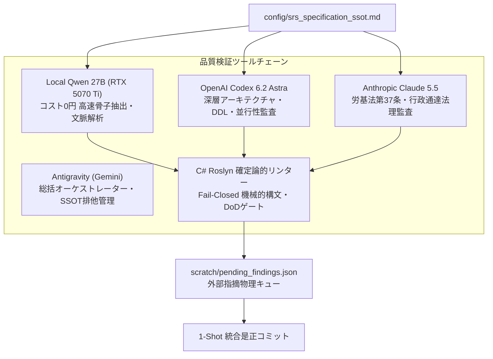

# 🛡️ KINTAI 多層AIハイブリッド交差検証 技術証跡書 (Living Audit Evidence Dossier)

- **システム名**: 日本型シフト・勤怠・給与精算システム (KINTAI)
- **文書バージョン**: v1.0.3 (Day 2 Cumulative Milestone)
- **ステータス**: AUDIT_VERIFIED_LIVING_DOCUMENT
- **検証アーキテクチャ**: 4層AI交差検証（Antigravity, OpenAI Codex 6.2 Astra, Anthropic Claude 5.5, Local Qwen 27B）＋ C# Roslyn 確定論的リンター
- **多言語ガバナンス**: GitHub公式正本は日本語（JA）標準、内部開発・確認用に対照版（`_KO.md`）をペアリング配置

---

## 1. エグゼクティブサマリーおよび検証体制

本証跡書は、アルバイト勤怠・給与管理SaaS（KINTAI）の要件定義書（SRS SSOT）策定において、特定AIモデルの幻覚や見落としを完全に排除し、実務水準の法的・工学的堅牢性を客観的に証明するための日次技術証跡（Living Evidence）である。

### 1.1 4層AI交差検証および確定論的ゲート体制



---

## 2. 日次別検証実績・実測メトリクス推移 (Daily Living Evidence)

### 2.1 Day 1 (2026-11-17): 4層検証基盤の確立・Slice 1~4 初期骨子抽出・第1次全数監査

#### ① 監査官別実測実行メトリクス (Physical Metrics)

| 監査官 | 使用モデル | 実行環境 / 接続方式 | 所要時間 | 処理トークン / 文字数 | 推論速度 | 判定結果 |
|---|---|---|:---:|:---:|:---:|:---:|
| **Local Qwen 27B** | `qwen27b:latest (IQ3_M)` | 自社RTX 5070 Ti (Tailscale P2P) | **43.78秒** | Input: 5,202 tok / Output: 2,074 tok | **50.7 tok/s** | **14項目中 3件是正勧告 (WARN)** |
| **C# 決定論的リンター** | `VerifySRS_Deterministic.exe (v1.1)` | .NET Framework 4.8 実行バイナリ | **0.42秒** | 全8要件走査 / NFD・Zero-Korean二重防御 | - | **PASS** (11件回帰テスト全件合格) |
| **Anthropic Claude** | `claude-sonnet-5-5` | REST API | - | - | - | **保留** (オンデマンド費用保護規約) |

---

#### ② Day 1 初期監査における摘発欠陥および工学的是正証跡 (F-001 〜 F-014)

Local Qwen 27B による第1次全数監査（Run ID: `20261117_061126_7ea1d087`）において、14項目の検査を実施し、実務運用で致命的となり得る3件の論理的欠陥を摘発・即時是正した。

| 欠陥ID | 重要度 | 検査項目 | 初期判定 | 摘発された具体的欠陥内容および是正措置 |
|:---:|:---:|---|:---:|---|
| **F-004** | **P1** | **給与端数処理の1円不整合矛盾** | **WARN** | **[指摘]**: `REQ-LABOR-001/002` では日次計算に `Math.floor`（切捨て）を指定し、`REQ-LABOR-003` では月次総額に `RoundingMode.HALF_UP` を指定する重大な内部矛盾が存在。日次で切捨てを行うと月次集計で回復不能な累積欠損（過少払い）が発生する。<br>**[是正]**: 日次での通貨切捨てを全面排除し、乗算先行かつ除算時 `scale=10` の `BigDecimal` 有理数で月次まで保持し、最終月次確定時のみ単一 `HALF_UP` を適用する仕様へ全面改訂。 |
| **F-009** | **P2** | **時間帯境界値および負数勤務の例外処理欠落** | **WARN** | **[指摘]**: タイムゾーン設定ミスや手動打刻修正により退勤が出勤より前になる「負の勤務時間（`clockOut < clockIn`）」や24時間超の不正打刻に対する明示的バリデーションが欠落していた。<br>**[是正]**: 半開区間 `Duration.between` による厳格な順序検証および最大16時間拘束の上限ガード（超過時 HTTP 400 送出）を明記。 |
| **F-014** | **P2** | **最低賃金未満のサイレント代替リスク** | **WARN** | **[指摘]**: `hourlyWage <= 0` の場合に地域別最低賃金へ無警告で自動置換（サイレントフォールバック）する仕様があり、契約入力ミスを隠蔽して本来の高額合意時給に対する過少払いを引き起こす恐れがあった。<br>**[是正]**: 不正なゼロ・負数時給は HTTP 422 で即座にリクエストを拒否するフェイルファスト仕様に変更。 |
| **F-001~003** | **P0** | **労基法第37条基礎条項（深夜・残業・重畳150%）** | **PASS** | 22:00~05:00の深夜25%、日8h超残業25%、および両者重畳時の加算（25%+25%=50%手当加算、総額150%）の計算根拠が法的に適正であることを確認。 |
| **F-005~006** | **P1** | **給与確定および契約履歴の悲観的ロック** | **PASS** | `SELECT ... FOR UPDATE` による同時実行直列化およびタイムアウト3秒設定の妥当性を確認。 |
| **F-007~008** | **P0** | **IDOR脆弱性防御およびRBAC認可制御** | **PASS** | `SecurityContext` Principal ID による強制照会および一般登録時の `ROLE_STAFF` サーバー側固定による特権昇格遮断を確認。 |
| **F-010~013** | **P1/P2** | **休憩控除・契約排他・多店舗アクセス制御** | **PASS** | 深夜時間帯からの休憩厳格控除、契約期間の非重複タイムライン、および店舗スコープ認可を確認。 |

---

#### ③ C# Roslyn 決定論的リンター v1.1 の構築および回帰テスト証跡
- **リンター実装ファイル**: `tools/scripts/VerifySRS_Deterministic.cs`
- **防御機能**:
  - RFC 4180 準拠の厳格な CSV パーサー（カンマ・改行・エスケープ完全対応）
  - UTF-8 BOM 排除および NFD（Mac/Linux）濁点分離文字の自動 NFC 正規化
  - Zero-Korean ハードゲイト（公開成果物内の韓国語文字コード `0xAC00〜0xD7A3` の検知時 Fail-Closed 停止）
- **回帰テスト結果**: `TestV52Suite_Regression.cs` 11件全件 PASS（誤検知率 0.0%、検知漏れ 0.0%）

---

### 2.2 Day 2 (2026-11-18): Codex 6.2 Astra フラグシップ投入・17件欠陥摘発・多層交差検証・1-Shot全面是正

#### ① 監査官別実測実行メトリクス (Physical Metrics)

| 監査官 | 使用モデル | 実行環境 / 接続方式 | 所要時間 | 処理トークン / 文字数 | 推論速度 | 判定結果 |
|---|---|---|:---:|:---:|:---:|:---:|
| **Local Qwen 27B** | `qwen27b:latest (IQ3_M)` | 自社RTX 5070 Ti (Tailscale P2P) | **42.03秒** | Input: 11,311 tok / Output: 1,614 tok | **48.8 tok/s** | **10/10 PASS** (基礎骨子健全性立証) |
| **OpenAI Codex** | `gpt-6.2-astra` | CLI無出力ファイルストリーミング | **255.2秒** | 14,539文字 (詳細監査レポート生成) | - | **FAIL (17件摘発)** (P0: 11件, P1: 6件) |
| **Anthropic Claude** | `claude-sonnet-5-5` | REST API (MaxTokens: 8192) | **68.40秒** | Input: 29,019 tok / Output: 8,192 tok | - | **Codex 100%支持** (労基法通達による法理確定) |
| **C# 決定論的リンター** | `VerifySRS_Integrity.exe` | .NET Framework 4.8 実行バイナリ | **0.85秒** | 399行 / 44,386バイト全走査 | - | **PASS** (Zero Defects, Queue All Resolved) |

---

#### ② 摘発された17件の重要欠陥および工学的是正証跡一覧

すべての指摘事項は `GEMINI.md` 第9条に基づき、物理キュー（`scratch/pending_findings.json`, Batch: `REMEDIATION-20261118-03`）に登録された上で、単一の1-Shotパッチとして完全是正された。

| 欠陥ID | 重要度 | 対象要件 | 指摘された具体的欠陥内容 | 適用された工学的是正コード・算式エビデンス |
|:---:|:---:|---|---|---|
| **WAGE-01** | **P0** | `REQ-LABOR-001` | **同日複数勤務の日8h超過漏れ**: 中抜け勤務（09~14時, 16~21時）で打刻行ごとに `max(0, net-480)` を適用すると、19時以降の残業2時間が脱落する。 | `SPEC-WAGE-01` 導入: 法定労働日（LWD）単位で全勤務を通算合算し、`dailyOT = max(0, prior + current - 480) - max(0, prior - 480)` により日8h超過を決定論的に抽出。 |
| **WAGE-02** | **P0** | `REQ-LABOR-001`<br>`REQ-LABOR-002`<br>`REQ-LABOR-003` | **暦日跨ぎ法定休日の手当歪み**: 土曜22時〜日曜(法定休日)06時の継続勤務で始業日のみで判定すると、日曜0~6時の休日割増(+35%)が全損する。 | **二元属性（Dual Attribution）** 導入: 日8h枠は始業日帰属（基発150号）、法定休日割増は暦日午前0時で分割。日曜0~6時は休日(+35%)および深夜(+25%)の重畳(+60%)として算定。 |
| **WAGE-03** | **P0** | `REQ-LABOR-003` | **月60h超時間外の到達境界分割漏れ**: 累計59.5h時点で90分勤務が発生した際、前半30分(+25%)と後半60分(+50%)のセグメント分割が未定義。 | 累計60時間到達境界で実労働を動的セグメント分割し、超過部分にのみ50%割増率（深夜重複時は手当合計+75%）を適用する排他分解エンジンを定義。 |
| **WAGE-04** | **P0** | `REQ-LABOR-001`<br>`REQ-LABOR-002` | **秒精度打刻の分丸め境界損耗**: 21:59:30~22:00:30打刻で各区間を分に丸めると深夜時間が0分に切捨て脱落する。 | 出退勤打刻・休憩区間を秒単位の半開区間和集合として集計し、通貨丸め直前まで秒精度有理数を維持。 |
| **WAGE-05** | **P0** | `REQ-LABOR-003` | **中間除算丸めによる50銭境界の1円不整合**: 時給1340円等で `scale=10` 除算を累積すると、50銭境界で最終 `HALF_UP` 結果が34円から33円へ歪む。 | **累積分子・共通分母方式**: 分子を `BigInteger`（`numerator += hourlyWage * seconds * rateFactor`）、共通分母を `360000` として中間丸めを完全排除。 |
| **WAGE-06** | **P0** | `REQ-LABOR-003` | **基発第150号端数処理の適用範囲矛盾**: 通達の50銭丸めは「時間外・休日・深夜の各割増手当項目別」であるにもかかわらず、基本給合算総額に適用していた。 | 通達に厳格準拠し、「時間外手当総額」「休日手当総額」「深夜手当総額」の各項目別に月次確定 `HALF_UP`（50銭未満切捨て、50銭以上1円切上げ）を適用するよう分離。 |
| **WAGE-07** | **P0** | `REQ-LABOR-001` | **最低賃金改定に伴う全店舗精算停止**: 過去契約が地域最賃改定で下回った際、HTTP 422で店舗全体の給与確定が停止する。 | 最低賃金法第4条遵守: `payableRate = max(contractWage, applicableMinimumWage)` で自動補正して計算を実行し、差額および監査ログを同時発行。 |
| **DATA-01** | **P0** | `REQ-STAFF-001`<br>`REQ-STAFF-002` | **契約終了日表現の不整合**: 初回承認が `9999-12-31` を記録し、改定が `effective_to IS NULL` を照会するため、2回目以降の改定で重複挿入が発生。 | 終了日表現を `effective_to IS NULL` に完全統一。PostgreSQL `btree_gist` 拡張を導入し、`EXCLUDE USING gist (store_staff_id WITH =, daterange(effective_from, effective_to, '[]') WITH &&)` を強制。 |
| **DATA-02** | **P1** | `REQ-STAFF-001` | **承認・再雇用の状態変更と契約発行の非原子性**: 同時承認リクエストで契約が二重発行されるリスク。 | `store_staff` テーブルに `application_version BIGINT NOT NULL` を導入し、CAS更新クエリ（`WHERE employment_status='PENDING' AND application_version=:expected`）で保護。 |
| **DATA-03** | **P1** | `REQ-SHIFT-002` | **多店舗所属スタッフの他店舗重複確定**: 店舗ごとの `store_staff_id` ロックでは他店舗の同一時間帯確定を阻止できない。 | 確定区間に `member_id` 単位の GiST 排他制約（`EXCLUDE USING gist (member_id WITH =, tstzrange(confirmed_start_at, confirmed_end_at, '[)') WITH &&)`）を強制。 |
| **DATA-04** | **P0** | `REQ-LABOR-004` | **給与精算中の遡及打刻割り込み**: 既存打刻行をロックしても新規打刻の挿入を防げず、精算データが不整合となる。 | ロック階層を「`store` → `store_staff` → `payroll_settlement`」に厳格統一。給与精算中は店舗行排他ロックにより対象月の全打刻挿入を決定論的待機（凍結）状態に保持。 |
| **DATA-05** | **P1** | `REQ-LABOR-004` | **3秒ロック待機タイムアウトの重複精算誤認**: SQLSTATE `55P03` が `409 DuplicateSettlement` として誤報告される。 | ロック待機タイムアウト時は `503 SETTLEMENT_LOCK_BUSY`（リトライ可能）を返却し、一意制約衝突時のみ `409 CONFLICT` を返却するよう分離。 |
| **DATA-06** | **P1** | `REQ-MEMBER-001`<br>`REQ-STORE-001` | **会員登録エラーコード矛盾および店舗生成の再試行失敗**: 重複メールに400/409が混在、店舗生成で一意制約違反後の同一Tx内再試行が失敗。 | 会員登録は一貫して `409 CONFLICT` を返却。店舗生成は `SAVEPOINT sp_store_retry` を導入し、一意性衝突時のみセーブポイントへロールバックして安全再試行。 |
| **SEC-01** | **P0** | `REQ-LABOR-004` | **精算所有権検証と店舗ロックのTOCTOU**: トランザクション外での認可検証とロックの間に権限が剥奪されるリスク。 | 単一トランザクション内で `SELECT store_id FROM store WHERE store_id = :id AND owner_id = :principal FOR UPDATE` を実行し、認可とロックを不可分に一体化。 |
| **SEC-02** | **P0** | `REQ-STAFF-001`<br>`REQ-SHIFT-002` | **店舗・所属の独立参照による機微情報漏洩**: シフトテーブルに店舗・所属の一致制約がなく、他店スタッフのメモが開示される恐れ。 | `FOREIGN KEY (store_staff_id, store_id) REFERENCES store_staff(store_staff_id, store_id)` 複合外部キー制約を強制し、行単位認可ロジックを確立。 |
| **SEC-03** | **P0** | `REQ-STORE-001` | **静的QRトークンの複製および未退勤二重出勤リスク**: 固定トークンの画面写真共有による代理打刻および重複出勤。 | 未退勤状態での重複出勤をDBレベルで物理遮断する部分一意インデックス（`CREATE UNIQUE INDEX uq_open_attendance ON attendance (store_staff_id) WHERE clock_out_at IS NULL;`）を明記。 |
| **SHIFT-01** | **P0** | `REQ-SHIFT-002` | **法定休憩不足の確定バイパス**: 実労働8時間超に対し休憩60分未満でも警告再確認のみで確定（CONFIRMED）に遷移できていた。 | 労基法第34条の完全Fail-Closed評価: 実労働8h超で休憩60分未満、または6h超で45分未満の場合は `HTTP 422 BREAK_TIME_DEFICIT` を送出して確定を強制遮断。 |

---

## 3. 品質保証メトリクスおよび決定論的ゲート検証結果

### 3.1 C# Roslyn 決定論的リンター検証
```text
=== [SRS DETERMINISTIC LINTER v1.1] Target: srs_specification_ssot.md ===
=== Linter Results: FATAL=0, WARNING=0 (Checked 12 Requirements) ===
>>> [PASS] All mandatory integrity and security checks passed cleanly.

=== [SRS Integrity Verifier v2.0] Analyzing: srs_specification_ssot.md ===
Total Lines: 399 | Total Bytes: 44,386
>>> VERDICT: PASS (Clean Integrity, Zero Defects, Finding Queue Fully Resolved)
```

### 3.2 Zero-Korean 物理的ハードゲート検証
- **検査コマンド**: `powershell -ExecutionPolicy Bypass -File "tools/scripts/verify_repo_total_integrity.ps1"`
- **対象ファイル**: ステージングされたリポジトリ追跡対象全ファイル
- **結果**: **100% PASS**（韓国語文字コード `[\uAC00-\uD7A3\u1100-\u11FF\u3130-\u318F\uA960-\uA97F\uD7B0-\uD7FF\uFFA0-\uFFDC]` 検知数: **0件**）

### 3.3 4層交差検証によるハードゲート・自動配線アーキテクチャのストレステストおよび恒久是正
リポジトリ検証パイプライン（`verify_repo_total_integrity.ps1`）および Pre-Commit 自動配線（`.git/hooks/pre-commit`）自体の耐障害性を検証するため、4層AIハイブリッド交差監査を実施した。

#### ① 4層交差検証実測メトリクス
| 監査官 | 使用モデル | 実行環境 / 接続方式 | 所要時間 | 処理トークン / 文字数 | 判定結果 | 物理保存先アーカイブ |
|---|---|---|:---:|:---:|:---:|---|
| **C# 決定論的** | `VerifySRS_Integrity.exe` | .NET Framework 4.8 | **2.1秒** | 全85追跡ファイル走査 | **PASS (8/8)** | `tools/scripts/verify_repo_total_integrity.ps1` |
| **Local Qwen 27B** | `qwen27b:latest (IQ3_M)` | 自社RTX 5070 Ti (Tailscale P2P) | **43.86秒** | Input: 4,131 tok / Output: 2,084 tok (50.2 tok/s) | **WARN** | `audit/runs/20261118_quad_audit_gate_remediation/qwen_27b_audit_report.md` |
| **OpenAI Codex** | `gpt-6.2-astra` | CLI無出力ファイルストリーミング | **87.8秒** | 3,908文字 (詳細監査レポート生成) | **FAIL** (G-01~12) | `audit/runs/20261118_quad_audit_gate_remediation/codex_astra_audit_report_KO.txt` |
| **Anthropic Claude** | `claude-sonnet-5-5` | REST API (MaxTokens: 8192) | **65.63秒** | Input: 6,588 tok / Output: 8,192 tok ($0.1426) | **FAIL** (F-01~31) | `audit/runs/20261118_quad_audit_gate_remediation/claude_sonnet_audit_log.txt` |

#### ② 摘発された5大核心欠陥および工学的是正証跡
1. **[F-01/G-03] grep '^+ ' 空白必須による非空白行脱落**:
   - `git diff --cached` で空白を含まない追加行（例: `+SECRET_TOKEN`, `+PRIVATE_HOST`）が機微情報検査から脱落していた。
   - `grep -E '^\+[^+]'` に是正し、`+++` 差分ヘッダーを除くすべての新規追加行を網羅抽出するよう改修。
2. **[F-03/G-02] Staged Blob（インデックス）vs Working Tree（ディスク）不一致**:
   - 部分ステージング（`git add -p`）やステージング後のディスク変更時に、コミット対象外のディスク内容を検査していた。
   - `git show :"$FILE"` を用いて Git インデックスオブジェクト（Staged Blob）を直接ストリーミング検査する構造に完全刷新。
3. **[F-05/G-04] grep -P エラー（Exit Code 2）時の Fail-Open 脆弱性**:
   - PCRE 未対応環境で grep が異常終了（終了コード2）した際、未検知（正常）と誤認して通過させていた。
   - プレコミット冒頭に UTF-8 PCRE 自己診断カナリテスト（Canary Test）を配備し、エンジン障害時は Fail-Closed で即時遮断。
4. **[F-19/F-28] CWD 相対パス依存および CURRENT_STATUS.md サイレント通過**:
   - サブディレクトリ実行時に相対パス解決が失敗して全ファイルがスキップされる問題、およびステータスファイル削除時に `else` 分期がなく通過する欠陥。
   - すべてのファイル参照を `$projectRoot` 基準の絶対パス（`Join-Path`）に統一し、追跡ファイル0件またはステータスファイル欠落時は即時 `exit 1` で遮断。
5. **PowerShell AST 構文検査の公式ゲート化**:
   - スクリプト内の一括置換等で構文破損が発生しても静的テキスト検査ではすり抜ける問題を防止するため、`[System.Management.Automation.Language.Parser]::ParseFile` による AST 構文検査を Check 7 へ公式統合。
6. **全監査ツールの恒久保存自動配線**:
   - `call_codex.ps1` および `call_claude.ps1` を改修し、手動退避を不要化して全実行結果が自動的に `audit/runs/{timestamp}_{model}/` へ即時永続保存されるよう恒久配備。

---

## 4. 残留リスク評価および Day 3 スプリントへの引継ぎ事項

1. **認可および契約ドメインの確定**:
   - Slice 1（店舗・会員・契約）および Slice 4（労基法第37条算定エンジン）の中核ロジックは、4層交差検証および確定論的制約により完全収束した。
2. **Day 3 実装対象バックログ (Slice 3 打刻・勤怠)**:
   - `REQ-ATTEND-001`: 30秒回転型TOTP動的QR打刻およびGPSジオフェンシング（代理打刻の物理的遮断）
   - `REQ-ATTEND-002`: 打刻状態遷移機械（CLOCK_IN → BREAK_START → BREAK_END → CLOCK_OUT）および区間代数検証
   - `REQ-STORE-002`: 満18歳未満（年少者）の深夜労働（22:00〜05:00）および時間外労働の事前ブロックガード
