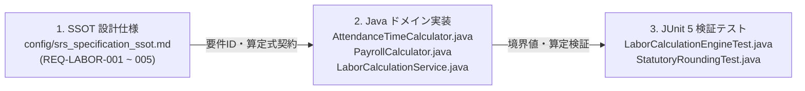

# 労働基準法第37条 SSOT ↔ Java ↔ JUnit 3層貫通トレーサビリティ仕様書

> **目的**: 日本国労働基準法第37条（時間外・深夜・重畳割増賃金）および昭和63年3月14日基発第150号（端数処理通達）に関する要件定義書（SSOT）、Javaドメイン実装、およびJUnit 5単体テストの対応関係と、現時点での検証済み範囲・未検証ギャップを物理的証跡（ファイルパス・行番号・メソッド名）に基づき明文化する。

---

## 1. 全体3層貫通アーキテクチャ

---

## 2. 労働基準法第37条 要件別 3層貫通マトリクス

| 要件ID (SSOT) | 規定内容・算定ルール (SSOT行番号) | Java 実装クラス・メソッド・行番号 | JUnit 5 検証テスト・未検証ギャップ |
|---|---|---|---|
| **REQ-LABOR-001** 日8時間・週40時間超過・未退勤遮断 | ・実労働時間（総拘束 − 休憩）の算出 ・1日8時間超過および週40時間超過の時間外抽出 ・未退勤打刻（`clockOutAt == null`）時の `IllegalStateException` 送出 （`srs_specification_ssot.md` L495-L529） | ・[`AttendanceTimeCalculator.java`](../domain_target/03_core_domain_services/AttendanceTimeCalculator.java) `calculateDetailed`（L123-L129）、`DetailedCalculationResult`（L70-L87） ・[`LaborCalculationService.java`](../domain_target/03_core_domain_services/LaborCalculationService.java) `calculateDetailedLabor`（L43-L81、未退勤例外 L53-L55） | ・**単体検証済** ([`LaborCalculationEngineTest.java`](../domain_target/05_core_domain_tests_fixtures/LaborCalculationEngineTest.java)):   - `standardDayShift_ShouldBeOnlyRegularWork`（L27：日8h通常）   - `overtimeDayShift_ShouldDistinguishStatutoryOvertime`（L53：日8h超残業）   - `clockOutBeforeClockIn_ShouldThrowException`（L192：逆順時刻 `IllegalArgumentException`）   - `breakOutOfRange_ShouldThrowException`（L203：休憩範囲外 `IllegalArgumentException`） ・**単体未検証ギャップ**: `clockOutAt == null` の `IllegalStateException` 分岐（L53-L55）および週40時間超過判定は `LaborCalculationEngineTest` に未収録（週次・統合範囲は `rtm_ledger.md` 側 `AnnualPayrollScenarioIntegrationTest` 管理） |
| **REQ-LABOR-002** 深夜労働割増（22:00 ~ 05:00 半開区間） | ・深夜時間帯（`[22:00, 05:00)`）の重複抽出 ・深夜帯に含まれる休憩時間の按分・厳密控除 ・基本時給に対する +25% 深夜割増 （`srs_specification_ssot.md` L533-L557） | ・[`AttendanceTimeCalculator.java`](../domain_target/03_core_domain_services/AttendanceTimeCalculator.java) `regularNightWorkMinutes`（L75）、`nightOvertimeWorkMinutes`（L77） ・[`PayrollCalculator.java`](../domain_target/03_core_domain_services/PayrollCalculator.java) `calculateDailyPay`（L95-L96）、`calculateDetailedDailyPay`（L126-L127） | ・**単体検証済** ([`LaborCalculationEngineTest.java`](../domain_target/05_core_domain_tests_fixtures/LaborCalculationEngineTest.java)):   - `nightBreakDeduction_ShouldDeductOnlyFromNightRange`（L102：深夜帯 `23:00` ~ `00:00` 休憩控除） ・**単体未検証ギャップ**: `22:00:00` 境界開始・`05:00:00` 境界除外の秒単位単体試験、および `21:50` ~ `22:10` 等の境界跨ぎ休憩按分テストは未収録 |
| **REQ-LABOR-003** 重畳割増マトリクス & 基発第150号端数処理 | ・通常 100%、所定内深夜 125%、法定外残業 125%、法定外深夜（重畳）150%（拡張仕様：月60h超 150%/175%、法定休日 135%/160%） ・1円未満四捨五入（`RoundingMode.HALF_UP`） ・月次端数処理規約の統制 （`srs_specification_ssot.md` L561-L604） | ・[`PayrollCalculator.java`](../domain_target/03_core_domain_services/PayrollCalculator.java)   - `calculateDetailedDailyPay`（L108-L145：総計視点 L117-L120 と区分別内訳視点 L124-L133）   - `yenRound`（L150-L153：`RoundingMode.HALF_UP`）   - `StatutoryRounding`（L158以降） | ・**単体検証済**:   - [`LaborCalculationEngineTest.java`](../domain_target/05_core_domain_tests_fixtures/LaborCalculationEngineTest.java): `overlappingNightOvertime_ShouldCalculateDoubleAdditionCorrectly`（L76）、`overlappingNightOvertime_PayEquivalenceTest`（L138：時給1,500円フィクスチャ）、`yenRounding_ShouldRoundHalfUpCorrectly`（L177）   - [`StatutoryRoundingTest.java`](../domain_target/05_core_domain_tests_fixtures/StatutoryRoundingTest.java): `testRoundDownAt29Minutes`（L21）、`testRoundUpAt30Minutes`（L28）、`testRoundUpAt59Minutes`（L35）、`testRoundDownAt49Sen`（L46, L64）、`testRoundUpAt50Sen`（L53, L71） ・**単体未検証ギャップ**: 複数日合算後の月次区分別丸め統合試験、および月60h超（150%/175%）・法定休日（135%/160%） |
| **REQ-LABOR-004** 悲観的ロック・一意制約・給与確定整合性 | ・親テーブル先行悲観的ロック、`uq_settlement_store_month`、行排他ロックによる二重確定防止 （`srs_specification_ssot.md` L608-L643） | ・算定エンジン単体対象外（[`PayrollService.java`](../domain_target/03_core_domain_services/PayrollService.java) 側トランザクション境界に実装） | ・[`rtm_ledger.md`](../domain_target/01_specifications_and_rtm/rtm_ledger.md) L33 記録：`PayrollSettlementConcurrencyTest`（統合・DB競合テスト対象、本算定単体フィクスチャ外） |
| **REQ-LABOR-005** 最低賃金マスタ・単一支給時給連携 | ・契約時給の最低賃金下回り防止および単一支給時給 `appliedHourlyWage` の継承 （`srs_specification_ssot.md` L393-L425） | ・[`LaborCalculationService.java`](../domain_target/03_core_domain_services/LaborCalculationService.java) `minHourlyWage = 1280`（L31-L32）、`findHourlyWageForStaffOnDate` フォールバック適用（L71-L75） | ・[`rtm_ledger.md`](../domain_target/01_specifications_and_rtm/rtm_ledger.md) L28 記録：`MinimumWageAutoAdjustmentTest`（統合回帰側。現行 `LaborCalculationEngineTest` には未収録） |

---

## 3. 数式レベルの実装一致検証および端数丸め差異（PayrollCalculator.java）

[`PayrollCalculator.java`](../domain_target/03_core_domain_services/PayrollCalculator.java) L123-L134 では、総計視点（基本給100% + 深夜25% + 残業25%）と区分別内訳視点（通常100%・所定内深夜125%・法定外125%・法定外深夜150%）の2経路を定義している。

- **所定内通常（100%）**: `hourlyWage * regularWorkMinutes / 60`（L124）
- **所定内深夜（125%）**: `hourlyWage * 5 * regularNightWorkMinutes / 240`（L127）
- **法定外通常（125%）**: `hourlyWage * 5 * overtimeWorkMinutes / 240`（L130）
- **法定外深夜（150% 重畳割増）**: `hourlyWage * 3 * nightOvertimeWorkMinutes / 120`（L133）
- **円未満端数処理**: `numerator.divide(BigDecimal.valueOf(denominator), 0, RoundingMode.HALF_UP).intValueExact()`（L150-L153）

> **丸め段階に関する境界注記（2経路等価性の前提条件）**:  
> `overlappingNightOvertime_PayEquivalenceTest`（L138）は時給 `1,500円` フィクスチャにおいて両経路の一致を検証している。一方、`calculateDetailedDailyPay` は各区分に対して個別に `yenRound`（日別・成分別 `HALF_UP`）を適用するため、任意の端数を含む入力（例：時給 `1,280円`、`21:58` ~ `22:01`、休憩・残業なし）では、総計経路（`round(1280*3/60)=64` + `round(1280*1/240)=5` = **69円**）と区分別経路（`round(1280*2/60)=43` + `round(1280*5/240)=27` = **70円**）の間で1円の丸め差が生じ得る。SSOT [`REQ-LABOR-003`](../config/srs_specification_ssot.md)（L586-L590）では、この中間丸め差異を回避するため `BigInteger` 共通分母（`360000`）による月次一括 `HALF_UP` を規定している。

---

## 4. As-Designed（SSOT拡張仕様）と As-Built（現行Javaフィクスチャ）の境界注記

`domain_target/` 配下のJavaフィクスチャと [`srs_specification_ssot.md`](../config/srs_specification_ssot.md) の間には、以下の検証済み範囲および将来拡張境界が存在する。

1. **現行Javaフィクスチャで直接実装・単体テスト済みの範囲**:
   - 4区分タイムライン・スライシング（100% / 125% / 125% / 150%）、深夜帯 `[22:00, 05:00)` 休憩控除、`RoundingMode.HALF_UP` 円単位丸め、および `StatutoryRounding` ユーティリティ（29分切捨て/30分切上げ、49銭切捨て/50銭切上げ）。
2. **SSOT（Track 1 設計仕様）で定義されている拡張仕様（現行フィクスチャ外）**:
   - 月60時間超時間外割増（150% / 深夜重畳 175%）、法定休日労働（+35% / 深夜重畳 160%）の暦日00:00分割、`BigInteger` 共通分母（`360000`）による月次一括端数処理、および `prefecture_minimum_wage` 履歴テーブル連動の動的最低賃金補正。
   - これらは [`srs_specification_ssot.md`](../config/srs_specification_ssot.md)（L561-L604）において設計仕様として確定しており、次期実装スプリントの拡張対象として管理される。
